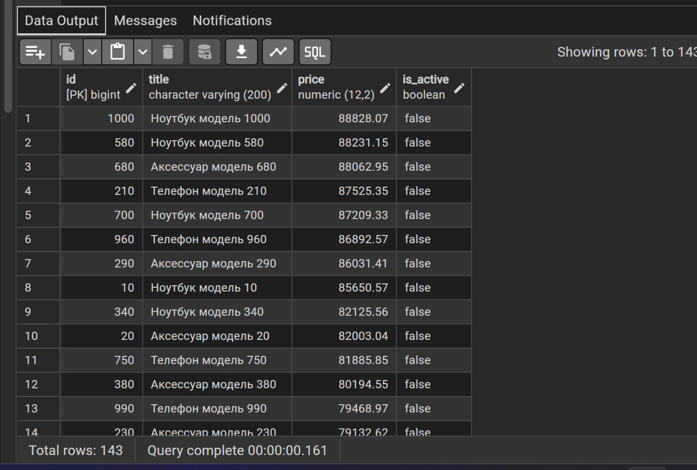
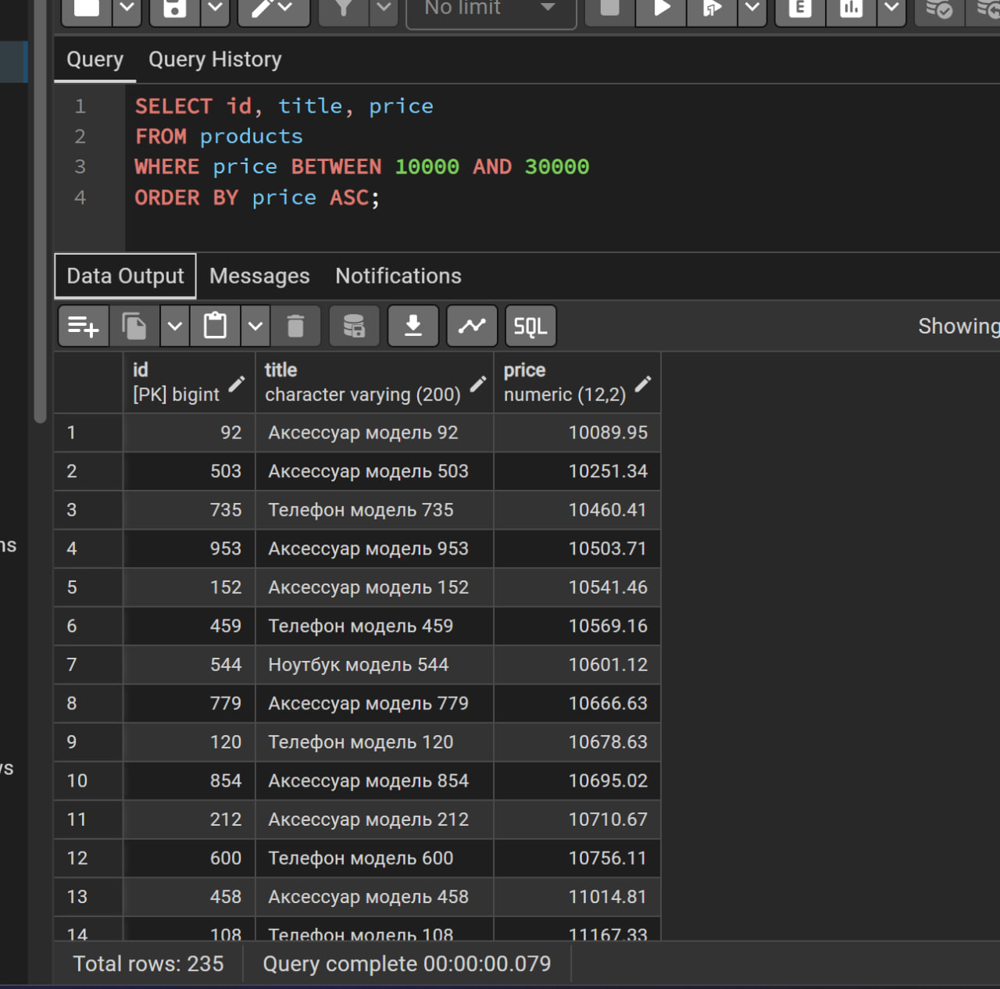
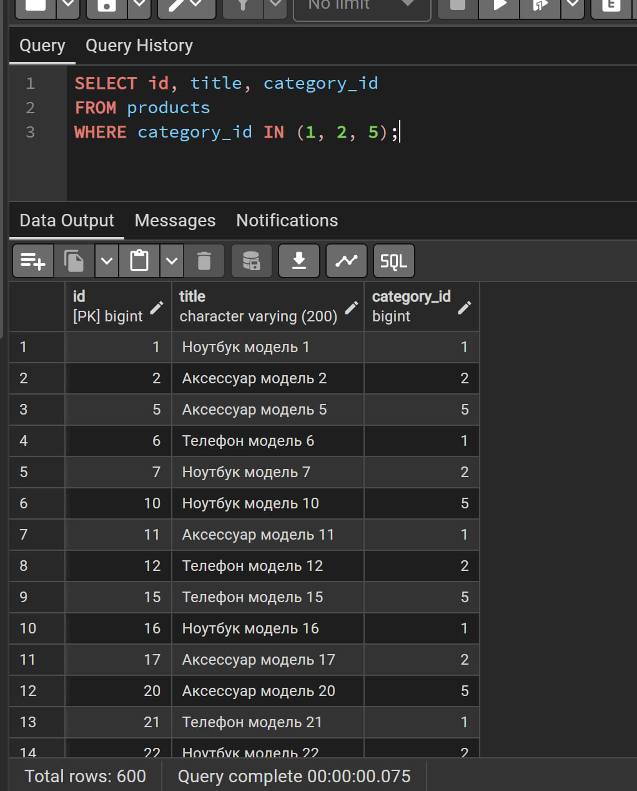
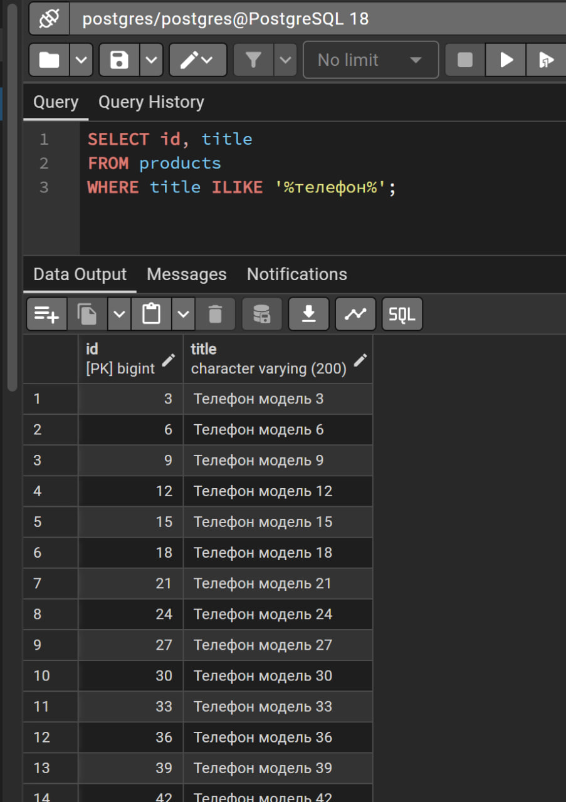
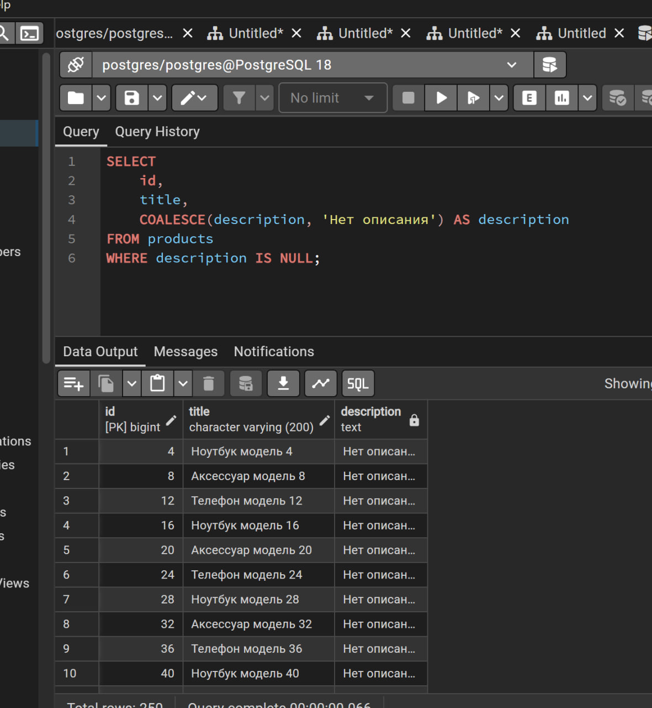
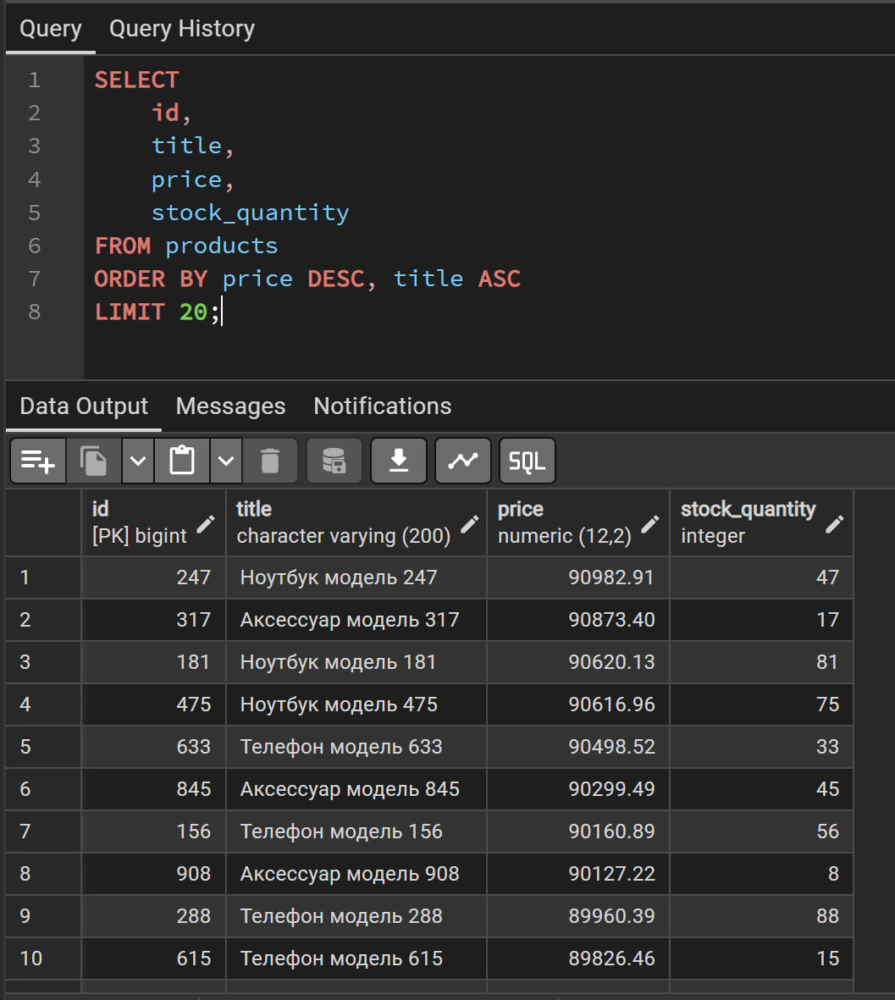
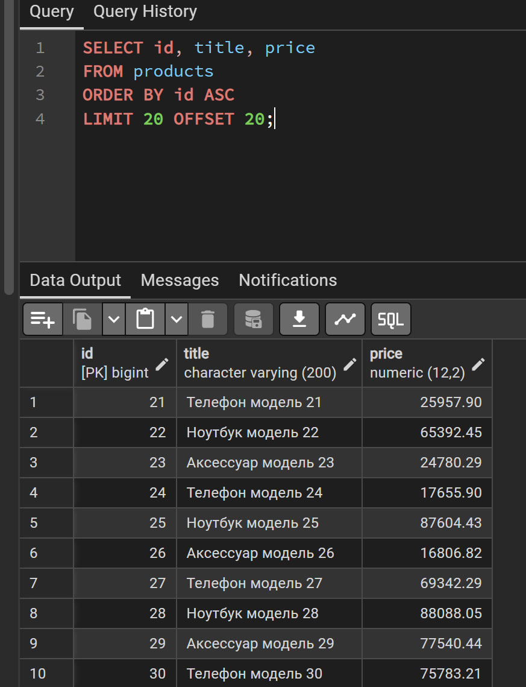

# Лабораторная работа № 2

## Базовые SQL-запросы и фильтрация данных
**Пирматова Мария БВТ2502**
**СУБД:** PostgreSQL\
**Среда выполнения:** pgAdmin 4\
**Тема:** заполнение таблиц тестовыми данными, выборка, фильтрация,
сортировка и постраничный вывод результатов.

------------------------------------------------------------------------

## 1. Цель работы

Изучить базовые возможности SQL в PostgreSQL: получение данных из
таблиц, устранение дубликатов, фильтрацию по нескольким условиям и
шаблонам, обработку `NULL`, сортировку и ограничение количества
возвращаемых строк.

## 2. Используемая база данных

В работе используется база данных маркетплейса, созданная в рамках
лабораторной работы № 1. В структуре предусмотрены таблицы
пользователей, продавцов, категорий, товаров, адресов, заказов, позиций
заказов, платежей, отзывов, избранного, доставок и истории статусов
заказов.

Для выполнения запросов лабораторной работы использовалась прежде всего
таблица `products`. В ней находятся поля `id`, `title`, `description`,
`category_id`, `price`, `stock_quantity` и `is_active`.

## 3. Заполнение таблиц тестовыми данными

Для формирования тестовых записей использовалась функция PostgreSQL
`generate_series()`, позволяющая создать последовательность значений и
на её основе вставить множество строк. Например, товары создавались
запросом вида:

``` sql
INSERT INTO products
    (seller_id, category_id, title, description, price, stock_quantity, is_active)
SELECT
    ((g - 1) % 10) + 1,
    ((g - 1) % 5) + 1,
    CASE
        WHEN g % 3 = 0 THEN 'Телефон модель ' || g
        WHEN g % 3 = 1 THEN 'Ноутбук модель ' || g
        ELSE 'Аксессуар модель ' || g
    END,
    CASE
        WHEN g % 4 = 0 THEN NULL
        ELSE 'Описание товара ' || g
    END,
    (1000 + random() * 90000)::numeric(12, 2),
    g % 100,
    (g % 10 <> 0)
FROM generate_series(1, 1000) AS g;
```

Этот запрос формирует 1000 товаров с разными названиями, случайными
ценами, количеством на складе и некоторыми отсутствующими описаниями.
Аналогично были заполнены другие таблицы. По скрипту заполнения
создаются 1000 пользователей, 1000 заказов и 1000 товаров; позиции
заказов и история статусов формируются отдельными запросами.

Для проверки количества записей можно выполнить:

``` sql
SELECT 'products' AS table_name, COUNT(*) AS row_count
FROM products
UNION ALL
SELECT 'orders', COUNT(*)
FROM orders;
```

## 4. Выполнение SQL-запросов

### 4.1. Уникальные значения и псевдонимы столбцов (`DISTINCT`, `AS`)

**Назначение:** выбрать сведения о товарах, присвоить столбцам понятные
псевдонимы, исключить полностью совпадающие строки и отсортировать
результат по названию.

``` sql
SELECT DISTINCT
    title AS product_name,
    category_id AS category,
    price AS product_price
FROM products
ORDER BY product_name
LIMIT 10;
```

`DISTINCT` удаляет повторяющиеся комбинации значений выбранных столбцов.
`AS` задаёт псевдонимы в результате запроса. `ORDER BY` сортирует
строки, а `LIMIT 10` ограничивает результат десятью строками.

**Результат:** запрос выполнен успешно. В сообщении о последнем запуске
в pgAdmin было указано 9 строк. В приложенном скриншоте этого запроса
отображён результат из 10 строк, поэтому число строк может различаться
между запусками или версиями данных.


### 4.2. Фильтрация по нескольким условиям (`AND`, `OR`, скобки)

**Назначение:** вывести активные товары с ценой от 1000 до 10000 либо
неактивные товары дороже 50000.

``` sql
SELECT id, title, price, is_active
FROM products
WHERE (price BETWEEN 1000 AND 10000 AND is_active = TRUE)
   OR (price > 50000 AND is_active = FALSE)
ORDER BY price DESC;
```

`AND` требует одновременного выполнения условий внутри каждой группы.
`OR` допускает выполнение хотя бы одной группы. Скобки задают порядок
объединения условий.

**Результат:** запрос выполнен успешно, возвращено 143 строки.



### 4.3. Выборка по диапазону (`BETWEEN`)

**Назначение:** выбрать товары, стоимость которых находится в диапазоне
от 10000 до 30000 включительно.

``` sql
SELECT id, title, price
FROM products
WHERE price BETWEEN 10000 AND 30000
ORDER BY price ASC;
```

Границы `BETWEEN` включаются в диапазон. `ASC` сортирует цену по
возрастанию.

**Результат:** запрос выполнен успешно, возвращено 235 строк.



### 4.4. Выборка по списку значений (`IN`)

**Назначение:** получить товары, относящиеся к категориям с
идентификаторами 1, 2 или 5.

``` sql
SELECT id, title, category_id
FROM products
WHERE category_id IN (1, 2, 5);
```

`IN` проверяет, соответствует ли значение одному из элементов указанного
списка.

**Результат:** запрос выполнен успешно, возвращено 600 строк.



### 4.5. Поиск по текстовому шаблону (`ILIKE`)

**Назначение:** найти товары, в названии которых встречается слово
«телефон», независимо от регистра букв.

``` sql
SELECT id, title
FROM products
WHERE title ILIKE '%телефон%';
```

В шаблоне `%телефон%` символ `%` означает любую последовательность
символов, в том числе пустую. `ILIKE` в PostgreSQL выполняет поиск без
учёта регистра.

**Результат:** запрос выполнен успешно, возвращено 333 строки.



### 4.6. Поиск отсутствующих значений (`IS NULL`)

**Назначение:** найти товары без описания и отобразить вместо `NULL`
поясняющий текст.

``` sql
SELECT
    id,
    title,
    COALESCE(description, 'Нет описания') AS description
FROM products
WHERE description IS NULL;
```

`IS NULL` проверяет отсутствие значения. `COALESCE` возвращает первый
аргумент, который не равен `NULL`; здесь он заменяет отсутствующее
описание только в выводе запроса, не изменяя данные таблицы.

**Результат:** запрос выполнен успешно, возвращено 250 строк.



### 4.7. Сортировка по двум столбцам (`ORDER BY`, `ASC`, `DESC`)

**Назначение:** вывести первые 20 товаров, отсортировав их по убыванию
цены, а при одинаковой цене --- по названию по возрастанию.

``` sql
SELECT
    id,
    title,
    price,
    stock_quantity
FROM products
ORDER BY price DESC, title ASC
LIMIT 20;
```

`DESC` задаёт сортировку по убыванию, `ASC` --- по возрастанию. При
сортировке по нескольким столбцам следующий столбец используется для
упорядочивания строк с одинаковыми значениями предыдущего столбца.

**Результат:** запрос выполнен успешно, возвращено 20 строк.



### 4.8. Постраничный вывод (`LIMIT`, `OFFSET`)

**Назначение:** получить вторую страницу списка товаров при размере
страницы 20 строк.

``` sql
SELECT id, title, price
FROM products
ORDER BY id ASC
LIMIT 20 OFFSET 20;
```

`OFFSET 20` пропускает первые 20 строк, а `LIMIT 20` возвращает
следующие 20. Сортировка по `id` обеспечивает предсказуемый порядок
страниц.

**Результат:** запрос выполнен успешно, возвращено 20 строк.



## 5. Сводная таблица результатов

  -----------------------------------------------------------------------
                          № Использованные               Количество строк
                            конструкции         
  ------------------------- ------------------- -------------------------
                          1 `DISTINCT`, `AS`,    9 по последнему запуску;
                            `ORDER BY`, `LIMIT`           10 на скриншоте

                          2 `WHERE`, `AND`,                           143
                            `OR`, `BETWEEN`,    
                            скобки              

                          3 `BETWEEN`,                                235
                            `ORDER BY`          

                          4 `IN`                                      600

                          5 `ILIKE`                                   333

                          6 `IS NULL`,                                250
                            `COALESCE`          

                          7 `ORDER BY`, `DESC`,                        20
                            `ASC`, `LIMIT`      

                          8 `ORDER BY`,                                20
                            `LIMIT`, `OFFSET`   
  -----------------------------------------------------------------------

## 6. Ответы на контрольные вопросы

### 1. В каком порядке логически выполняются части SELECT-запроса?

Логический порядок: `FROM` → `WHERE` → `GROUP BY` → `HAVING` → `SELECT`
→ `DISTINCT` → `ORDER BY` → `LIMIT`/`OFFSET`. Это логический порядок
обработки запроса, а не обязательно физический порядок действий
оптимизатора PostgreSQL.

### 2. Почему не рекомендуется постоянно использовать `SELECT *`?

`SELECT *` возвращает все столбцы, включая те, которые могут быть не
нужны. Явное перечисление столбцов делает запрос понятнее, уменьшает
объём возвращаемых данных и снижает зависимость запроса от изменений
структуры таблицы.

### 3. Для чего используется `WHERE`?

`WHERE` фильтрует строки по заданным условиям. Условия можно объединять
с помощью `AND`, `OR` и `NOT`; скобки позволяют явно задать порядок
логического вычисления.

### 4. Чем отличаются `BETWEEN` и `IN`?

`BETWEEN` проверяет попадание значения в диапазон и включает обе
границы. `IN` проверяет принадлежность значения заданному списку,
например `category_id IN (1, 2, 5)`.

### 5. Как работают `LIKE` и `ILIKE`?

`LIKE` сопоставляет текст с шаблоном, обычно учитывая регистр. `ILIKE` в
PostgreSQL выполняет сопоставление без учёта регистра. Символ `%`
заменяет последовательность символов, а `_` --- один символ.

### 6. Что такое `NULL` и как его проверять?

`NULL` обозначает отсутствующее или неизвестное значение. Выражение
`column = NULL` не используется для проверки отсутствия значения, так
как сравнение даёт `UNKNOWN`. Для проверки применяются `IS NULL` и
`IS NOT NULL`. В трёхзначной логике SQL существуют `TRUE`, `FALSE` и
`UNKNOWN`.

### 7. Как работает `ORDER BY`?

`ORDER BY` задаёт порядок строк. `ASC` сортирует по возрастанию, `DESC`
--- по убыванию. Можно указать несколько столбцов, а также управлять
расположением `NULL` с помощью `NULLS FIRST` и `NULLS LAST`.

### 8. Для чего нужны `LIMIT` и `OFFSET`?

`LIMIT` ограничивает число строк в результате, а `OFFSET` пропускает
указанное количество строк. Они часто применяются для постраничного
вывода. Для устойчивой пагинации рекомендуется задавать определённый
порядок сортировки.

### 9. Что делает `DISTINCT`?

`DISTINCT` удаляет дубликаты строк результата по всем выбранным
столбцам. Если выбрано несколько столбцов, сравнивается вся комбинация
их значений. В PostgreSQL также доступен `DISTINCT ON`, который
позволяет выбрать по одной строке для каждого значения указанного
выражения.

### 10. Для чего используется `generate_series()`?

`generate_series()` --- функция PostgreSQL для генерации
последовательности значений. Её можно использовать в `SELECT` и
`INSERT ... SELECT` для массового создания тестовых данных, например
последовательности от 1 до 1000.

## 7. Вывод

В ходе лабораторной работы были подготовлены тестовые данные для базы
данных маркетплейса и выполнены запросы для выборки, фильтрации,
сортировки и постраничного вывода данных. Были применены `DISTINCT`,
псевдонимы столбцов, логические операторы `AND` и `OR`, `BETWEEN`, `IN`,
`ILIKE`, `IS NULL`, `COALESCE`, `ORDER BY`, `LIMIT` и `OFFSET`.


