# Лабораторная работа № 3
## Многотабличные запросы и аналитические представления

**СУБД:** PostgreSQL  
**Инструмент:** pgAdmin 4  
**Тема:** соединение таблиц, агрегатные запросы, подзапросы, CTE и представления.

---

## 1. Цель работы

Освоить составление многотабличных SQL-запросов к базе данных маркетплейса, применение агрегатных функций и фильтрации групп, использование подзапросов и общих табличных выражений (CTE), а также создание представлений для типовых отчётов.

## 2. Задачи работы

1. Выполнить `INNER JOIN` не менее трёх таблиц.
2. Применить `LEFT JOIN` для поиска записей без соответствий.
3. Сгруппировать товары по категориям и рассчитать количество товаров и среднюю цену.
4. Применить `HAVING` для отбора групп по рассчитанному показателю.
5. Выполнить скалярный подзапрос, подзапрос с `IN` и подзапрос с `EXISTS`.
6. Использовать обычный CTE и рекурсивный CTE для обхода иерархии категорий.
7. Создать два представления и выполнить запросы к ним.

## 3. Ход работы

### 3.1. Внутреннее соединение трёх таблиц (`INNER JOIN`)

Соединим таблицы `products`, `categories` и `sellers`, чтобы получить сведения о товаре, его категории и продавце.

```sql
SELECT
    p.id AS product_id,
    p.title AS product_name,
    c.name AS category_name,
    s.company_name AS seller_name,
    p.price
FROM products AS p
INNER JOIN categories AS c
    ON c.id = p.category_id
INNER JOIN sellers AS s
    ON s.id = p.seller_id
ORDER BY p.id
LIMIT 10;
```

**Результат:** запрос выполнен успешно, получено 10 строк. Использованы связи по внешним ключам `products.category_id` и `products.seller_id`.

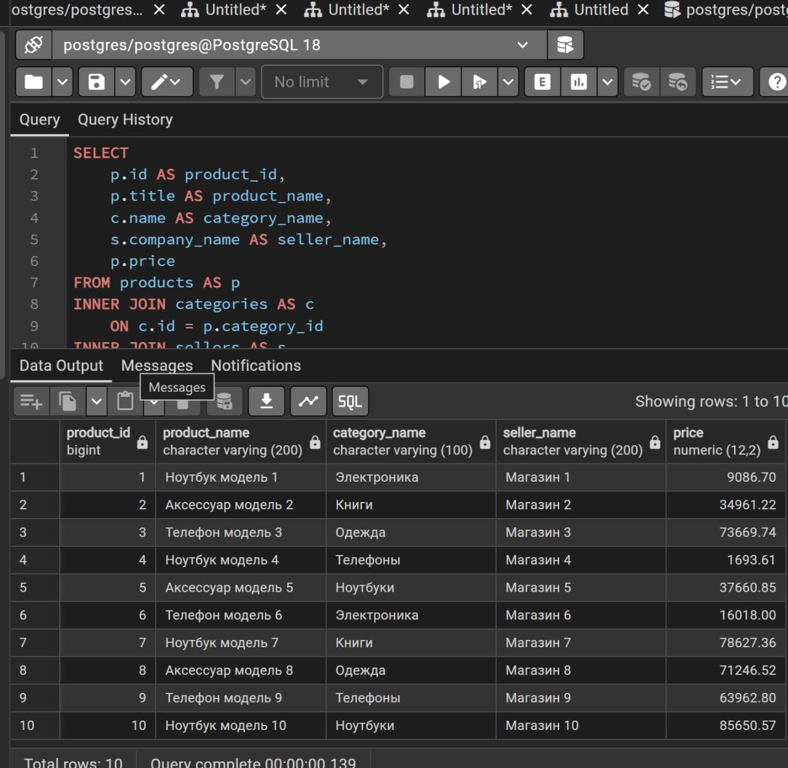

### 3.2. Поиск товаров без отзывов (`LEFT JOIN`)

Для поиска товаров, у которых отсутствуют отзывы, присоединим таблицу `reviews` к таблице `products`. Условие `r.id IS NULL` оставит только товары без совпадений в таблице отзывов.

```sql
SELECT
    p.id AS product_id,
    p.title AS product_name,
    r.id AS review_id,
    r.rating
FROM products AS p
LEFT JOIN reviews AS r
    ON r.product_id = p.id
WHERE r.id IS NULL
ORDER BY p.id
LIMIT 20;
```

**Результат:** запрос выполнен успешно, отображено 20 строк. Значения `review_id` и `rating` у выбранных товаров равны `NULL`. Вывод ограничен оператором `LIMIT 20`.

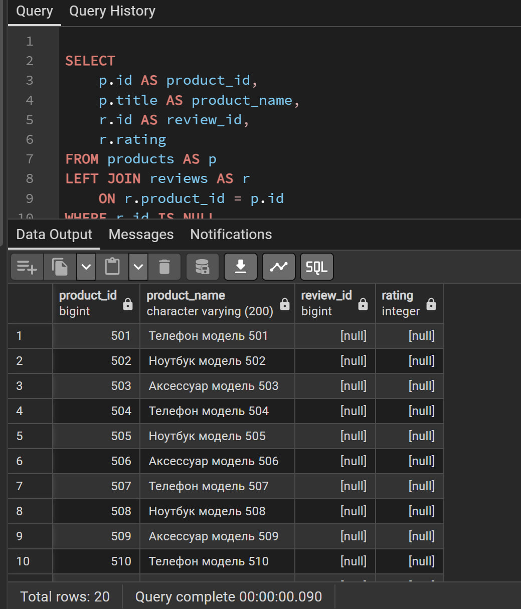

### 3.3. Группировка и агрегатные функции

Рассчитаем для каждой категории количество товаров и среднюю цену.

```sql
SELECT
    c.id AS category_id,
    c.name AS category_name,
    COUNT(p.id) AS product_count,
    ROUND(AVG(p.price), 2) AS average_price
FROM categories AS c
LEFT JOIN products AS p
    ON p.category_id = c.id
GROUP BY c.id, c.name
ORDER BY product_count DESC;
```

Здесь `COUNT(p.id)` подсчитывает товары, `AVG(p.price)` рассчитывает среднюю цену, а `ROUND(..., 2)` округляет её до двух знаков после запятой. `GROUP BY` формирует отдельную группу для каждой категории. Использование `LEFT JOIN` позволяет также показывать категории, у которых нет товаров.

**Результат:** получено 5 строк — по одной на каждую категорию.

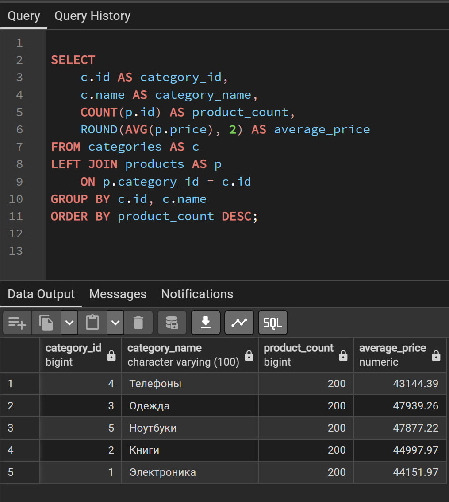

### 3.4. Фильтрация групп с помощью `HAVING`

Найдём продавцов, суммарная стоимость заказанных товаров у которых превышает 100 000.

```sql
SELECT
    s.id AS seller_id,
    s.company_name AS seller_name,
    SUM(oi.quantity * oi.unit_price) AS total_revenue
FROM sellers AS s
INNER JOIN products AS p
    ON p.seller_id = s.id
INNER JOIN order_items AS oi
    ON oi.product_id = p.id
GROUP BY s.id, s.company_name
HAVING SUM(oi.quantity * oi.unit_price) > 100000
ORDER BY total_revenue DESC;
```

Выражение `SUM(oi.quantity * oi.unit_price)` рассчитывает суммарную стоимость позиций заказов, связанных с товарами каждого продавца. `HAVING` фильтрует группы после группировки, оставляя продавцов с суммой выше заданного порога.

**Результат:** запрос выполнен успешно, получено 10 строк.

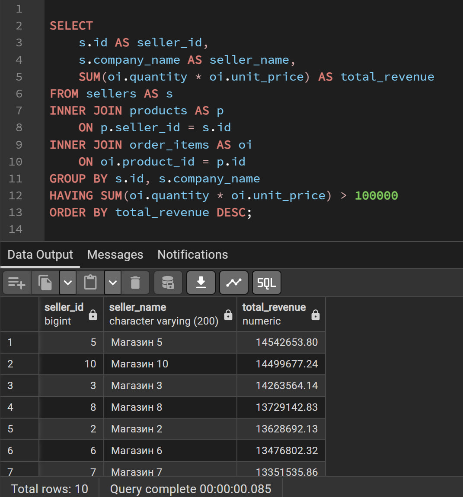

### 3.5. Скалярный подзапрос

Выберем товары, цена которых выше средней цены всех товаров.

```sql
SELECT
    id,
    title,
    price
FROM products
WHERE price > (
    SELECT AVG(price)
    FROM products
)
ORDER BY price DESC
LIMIT 20;
```

Внутренний запрос `SELECT AVG(price) FROM products` возвращает одно значение — среднюю цену. Внешний запрос использует это значение для фильтрации товаров.

**Результат:** запрос выполнен успешно, получено 20 строк.

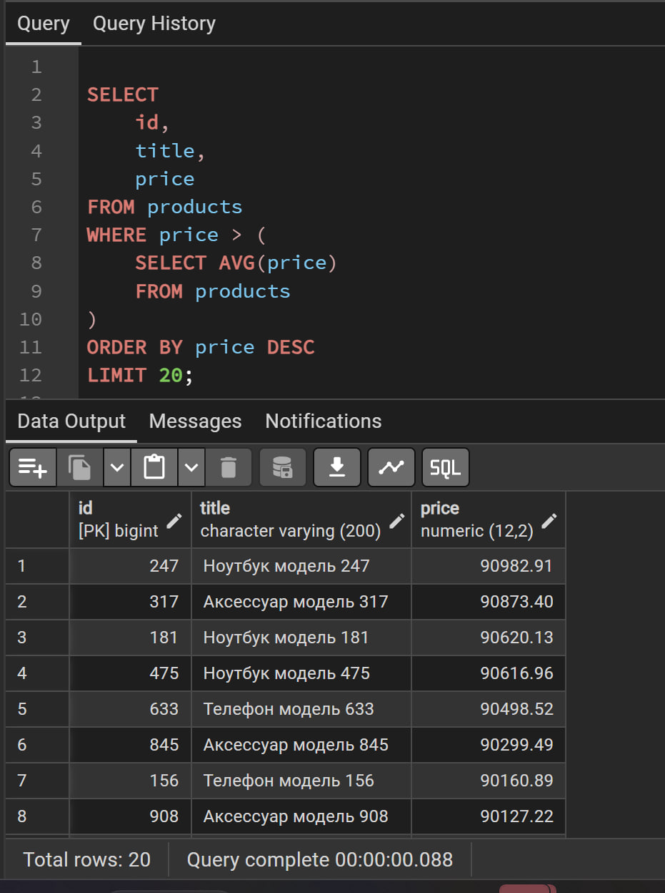

### 3.6. Подзапрос с `IN`

Выберем товары из категорий, в которых имеется хотя бы один товар дороже 80 000.

```sql
SELECT
    p.id,
    p.title,
    p.category_id,
    p.price
FROM products AS p
WHERE p.category_id IN (
    SELECT category_id
    FROM products
    WHERE price > 80000
)
ORDER BY p.category_id, p.price DESC
LIMIT 20;
```

Внутренний запрос возвращает идентификаторы категорий, в которых есть товары дороже 80 000. Оператор `IN` проверяет, входит ли категория каждого товара в этот список. При этом цена каждого товара во внешнем запросе не обязательно должна превышать 80 000.

**Результат:** запрос выполнен успешно, получено 20 строк.

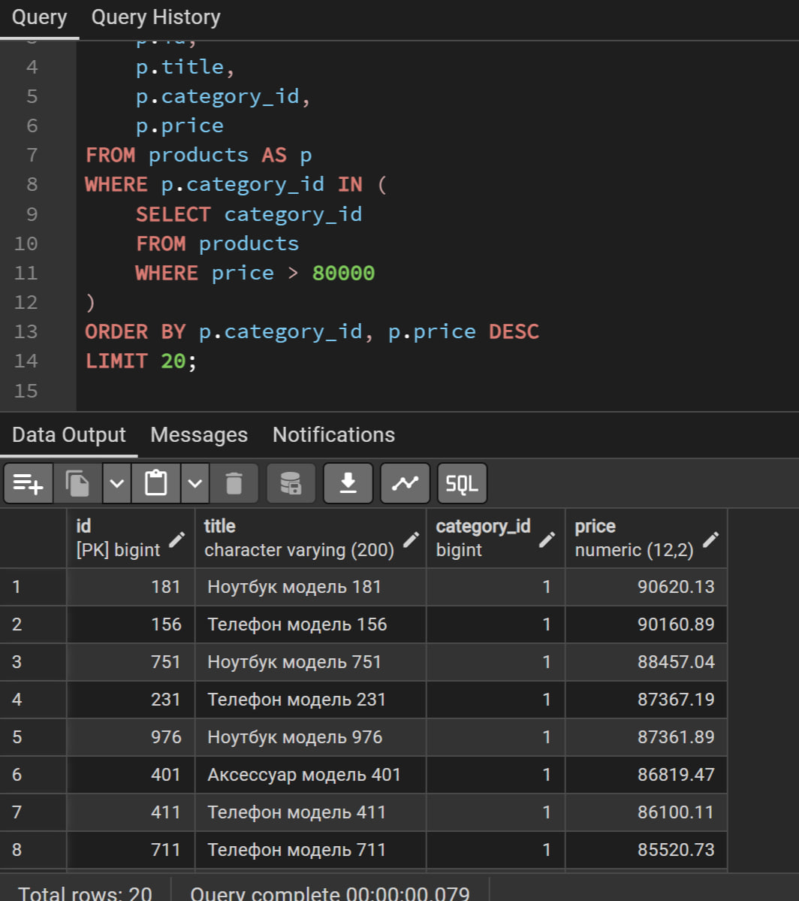

### 3.7. Коррелированный подзапрос с `EXISTS`

Выберем товары, для которых существует хотя бы один отзыв с рейтингом 4 или 5.

```sql
SELECT
    p.id,
    p.title,
    p.price
FROM products AS p
WHERE EXISTS (
    SELECT 1
    FROM reviews AS r
    WHERE r.product_id = p.id
      AND r.rating >= 4
)
ORDER BY p.id
LIMIT 20;
```

`EXISTS` проверяет наличие хотя бы одной строки, удовлетворяющей условиям подзапроса. Подзапрос является коррелированным, так как использует `p.id` из внешнего запроса в условии `r.product_id = p.id`. `SELECT 1` применяется потому, что важно само наличие строки, а не значения в ней.

**Результат:** запрос выполнен успешно, получено 20 строк.

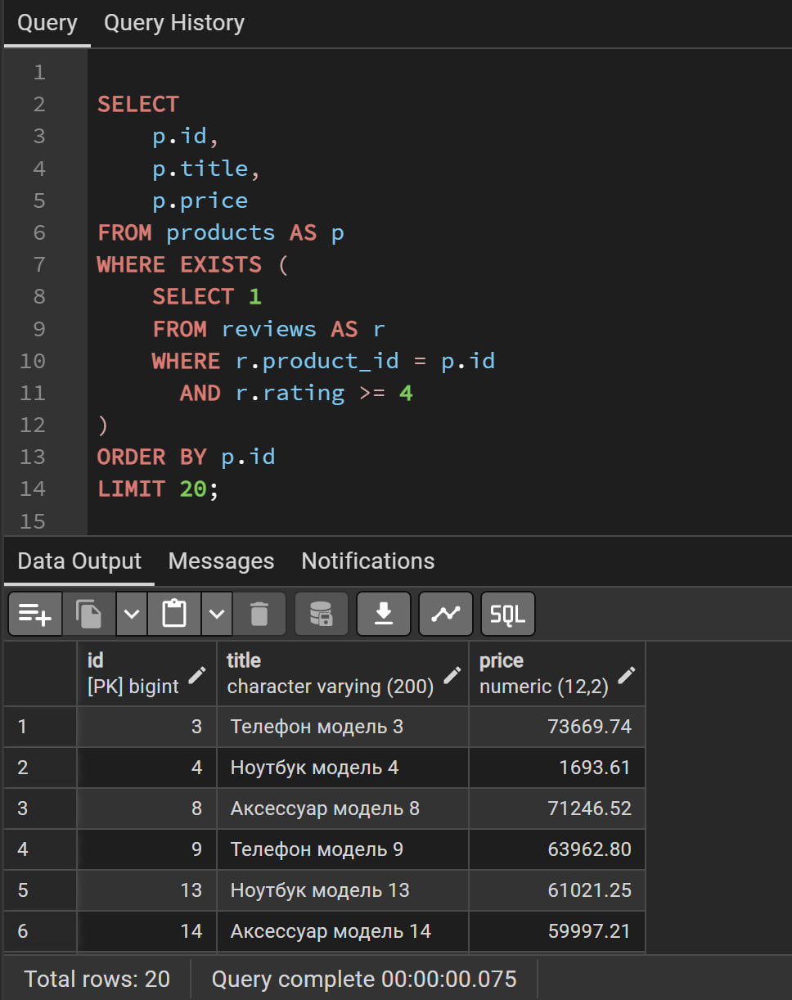

### 3.8. Общее табличное выражение (CTE)

Используем CTE для вычисления статистики по каждому продавцу, а затем выберем продавцов, у которых более 150 товаров.

```sql
WITH seller_stats AS (
    SELECT
        s.id AS seller_id,
        s.company_name AS seller_name,
        COUNT(p.id) AS product_count,
        ROUND(AVG(p.price), 2) AS average_price
    FROM sellers AS s
    LEFT JOIN products AS p
        ON p.seller_id = s.id
    GROUP BY s.id, s.company_name
)
SELECT
    seller_id,
    seller_name,
    product_count,
    average_price
FROM seller_stats
WHERE product_count > 150
ORDER BY product_count DESC;
```

CTE `seller_stats` формирует промежуточный именованный результат. Внешний запрос выполняет фильтрацию уже рассчитанной статистики.

**Результат:** запрос выполнен успешно, но вернул 0 строк, поскольку ни один продавец не удовлетворил условию `product_count > 150`. Это не ошибка выполнения: условие отбора просто не совпало с данными. При необходимости можно изменить порог, чтобы увидеть строки, однако исходный запрос демонстрирует применение CTE и фильтрацию его результата.

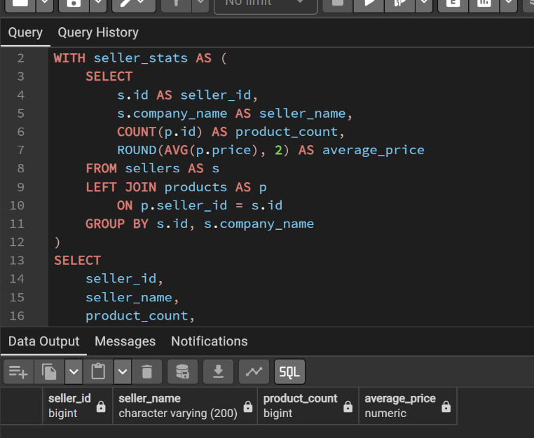

### 3.9. Рекурсивный CTE для дерева категорий

В таблице `categories` поле `parent_id` указывает на родительскую категорию. Рекурсивный запрос начинает с корневых категорий и последовательно находит дочерние категории.

```sql
WITH RECURSIVE category_tree AS (
    SELECT
        id,
        name,
        parent_id,
        1 AS level
    FROM categories
    WHERE parent_id IS NULL

    UNION ALL

    SELECT
        c.id,
        c.name,
        c.parent_id,
        ct.level + 1
    FROM categories AS c
    INNER JOIN category_tree AS ct
        ON c.parent_id = ct.id
)
SELECT
    id,
    name,
    parent_id,
    level
FROM category_tree
ORDER BY level, id;
```

Начальная часть запроса выбирает корневые категории (`parent_id IS NULL`). Рекурсивная часть присоединяет категории, у которых `parent_id` совпадает с `id` уже найденной категории. Поле `level` показывает глубину категории: `1` — корневая, `2` — дочерняя.

**Результат:** запрос выполнен успешно, получено 5 строк — все категории в иерархии. Отдельный скриншот этого запроса в приложенном документе отсутствует; результат выполнения был сообщён в ходе работы.

### 3.10. Создание и проверка первого представления

Создадим представление `product_details`, которое объединяет основные сведения о товарах, категориях и продавцах.

```sql
CREATE OR REPLACE VIEW product_details AS
SELECT
    p.id AS product_id,
    p.title AS product_name,
    c.name AS category_name,
    s.company_name AS seller_name,
    p.price,
    p.stock_quantity,
    p.is_active
FROM products AS p
INNER JOIN categories AS c
    ON c.id = p.category_id
INNER JOIN sellers AS s
    ON s.id = p.seller_id;
```

Проверим представление:

```sql
SELECT *
FROM product_details
ORDER BY product_id
LIMIT 10;
```

**Результат:** представление создано успешно; проверочный запрос вернул 10 строк. Представление позволяет получать сведения о товарах без повторного написания соединений таблиц.

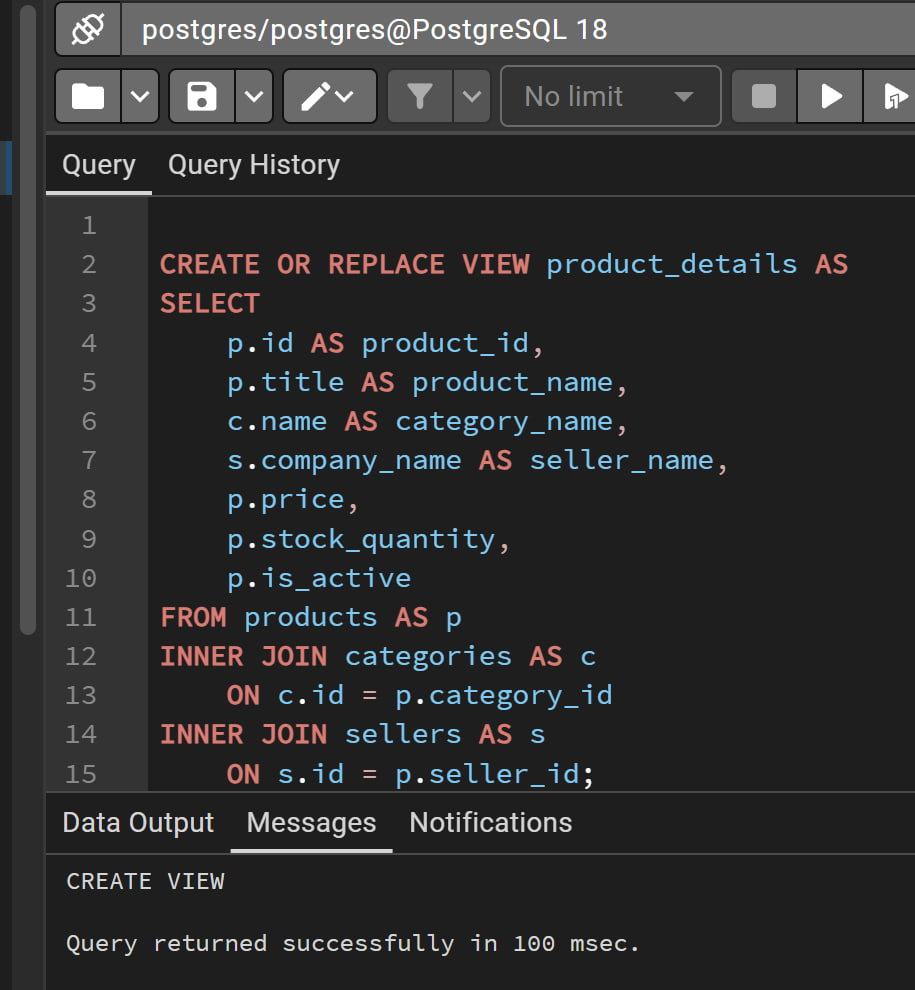

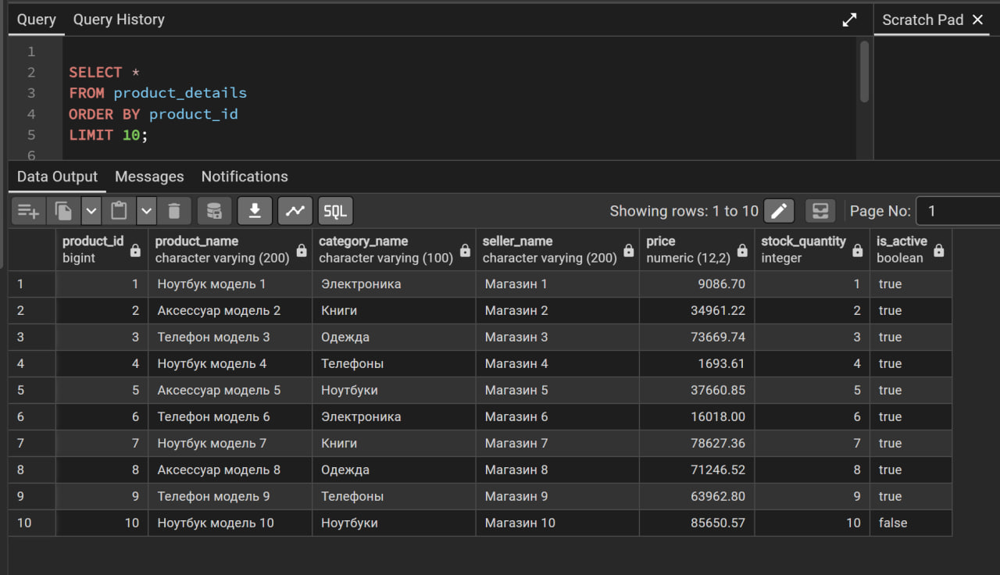

### 3.11. Создание и проверка второго представления

Создадим `category_statistics` для типового отчёта по категориям.

```sql
CREATE OR REPLACE VIEW category_statistics AS
SELECT
    c.id AS category_id,
    c.name AS category_name,
    COUNT(p.id) AS product_count,
    ROUND(AVG(p.price), 2) AS average_price
FROM categories AS c
LEFT JOIN products AS p
    ON p.category_id = c.id
GROUP BY c.id, c.name;
```

Проверим представление:

```sql
SELECT *
FROM category_statistics
ORDER BY category_id;
```

**Результат:** представление создано успешно; проверочный запрос вернул 5 строк — по одной на каждую категорию. В отчёте доступны идентификатор и название категории, количество товаров и средняя цена.

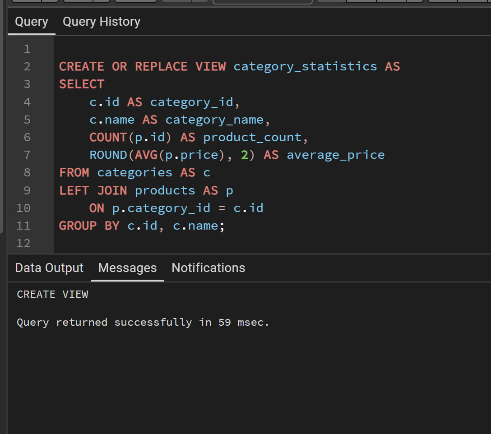

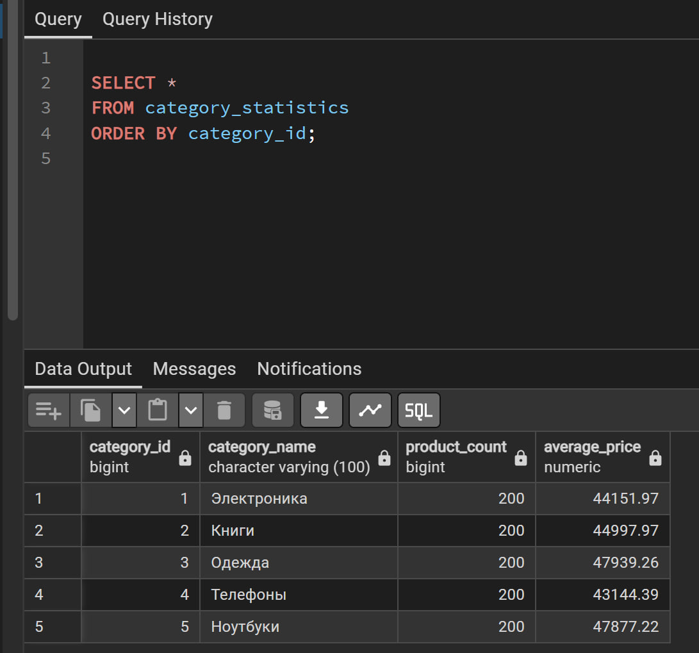

## 4. Итоги выполнения

| № | Требование | Результат |
|---:|---|---|
| 1 | `INNER JOIN` трёх таблиц | Выполнено, 10 строк |
| 2 | `LEFT JOIN` для поиска товаров без отзывов | Выполнено, 20 строк показано с `LIMIT 20` |
| 3 | `GROUP BY`, количество товаров и средняя цена по категориям | Выполнено, 5 строк |
| 4 | `HAVING` для отбора продавцов по выручке | Выполнено, 10 строк |
| 5 | Скалярный подзапрос, `IN`, `EXISTS` | Все три запроса выполнены, по 20 строк |
| 6 | CTE и рекурсивный CTE | Оба запроса выполнены; рекурсивный вернул 5 строк |
| 7 | Два представления и обращение к ним | Оба представления созданы и проверены |

## 5. Контрольные вопросы

### 1. Что такое соединение таблиц и по какому условию оно обычно выполняется?

Соединение (`JOIN`) объединяет данные из нескольких таблиц в одном запросе. Обычно оно выполняется по условию совпадения связанных столбцов, например первичного ключа одной таблицы и внешнего ключа другой. В работе товары соединялись с категориями по `products.category_id = categories.id`, а с продавцами — по `products.seller_id = sellers.id`.

### 2. Чем INNER JOIN отличается от LEFT JOIN? Приведите пример, где нужен именно LEFT JOIN.

`INNER JOIN` возвращает только строки с совпадениями в обеих таблицах. `LEFT JOIN` возвращает все строки левой таблицы и совпадающие строки правой; при отсутствии совпадения поля правой таблицы заполняются `NULL`. `LEFT JOIN` нужен, например, для поиска товаров без отзывов, чтобы товары не исчезали из результата из-за отсутствия связанного отзыва.

### 3. Какие агрегатные функции вы знаете? В чём различие между COUNT(*) и COUNT(столбец)?

Основные агрегатные функции: `COUNT()` — количество, `SUM()` — сумма, `AVG()` — среднее значение, `MIN()` — минимум, `MAX()` — максимум. `COUNT(*)` считает все строки, а `COUNT(column)` считает только строки, в которых указанный столбец не равен `NULL`.

### 4. Для чего предназначена секция GROUP BY и что допустимо в списке выборки при группировке?

`GROUP BY` объединяет строки с одинаковыми значениями указанных столбцов, чтобы агрегатные функции рассчитывались отдельно для каждой группы. В списке `SELECT` допустимы столбцы группировки, агрегатные выражения и выражения, допустимые по правилам группировки СУБД, например функционально зависимые от ключа группы столбцы.

### 5. В чём различие между WHERE и HAVING и в каком порядке они выполняются?

`WHERE` фильтрует строки до группировки, а `HAVING` фильтрует группы после `GROUP BY`. Упрощённый логический порядок: `FROM`/`JOIN`, `WHERE`, `GROUP BY`, `HAVING`, `SELECT`, `ORDER BY`, `LIMIT`/`OFFSET`.

### 6. Что такое подзапрос? Чем коррелированный подзапрос отличается от некоррелированного?

Подзапрос — это запрос, вложенный в другой SQL-запрос. Некоррелированный подзапрос не зависит от значений внешнего запроса. Коррелированный использует значения из внешнего запроса, например `p.id` внутри подзапроса `EXISTS`.

### 7. Как работает предикат EXISTS и когда его удобно применять?

`EXISTS` возвращает истину, если подзапрос возвращает хотя бы одну строку, и ложь, если строк нет. Его удобно использовать для проверки наличия связанных записей, например отзывов с высоким рейтингом у товара.

### 8. Что такое CTE и для чего нужен рекурсивный CTE?

CTE — это именованное табличное выражение, объявляемое через `WITH`. Оно помогает разбить сложный запрос на понятные этапы. Рекурсивный CTE (`WITH RECURSIVE`) позволяет обходить иерархические данные, например дерево родительских и дочерних категорий.

### 9. Что такое представление (VIEW)? Хранит ли обычное представление данные?

`VIEW` — это именованный SQL-запрос, к которому можно обращаться как к таблице. Обычное представление хранит определение запроса, а не отдельную физическую копию его результата. Данные извлекаются из исходных таблиц при обращении к представлению.

### 10. Чем материализованное представление отличается от обычного?

Обычное `VIEW` хранит определение запроса и получает данные при обращении. `MATERIALIZED VIEW` физически сохраняет результат запроса, поэтому чтение может быть быстрее для сложных отчётов, но сохранённый результат может устареть. В PostgreSQL материализованное представление обновляют командой `REFRESH MATERIALIZED VIEW`.

## 6. Заключение

В ходе лабораторной работы были составлены и выполнены многотабличные SQL-запросы к базе данных маркетплейса. Были применены `INNER JOIN` и `LEFT JOIN`, агрегатные функции, группировка и фильтрация групп с помощью `HAVING`. Реализованы скалярный подзапрос, подзапрос с `IN` и коррелированный подзапрос с `EXISTS`. Для структурирования запросов использован CTE, а для обхода иерархии категорий — рекурсивный CTE. Созданы и проверены два представления: `product_details` и `category_statistics`.

Таким образом, все семь пунктов технического задания выполнены. Полученные запросы и представления демонстрируют способы объединения данных, проведения аналитических расчётов и повторного использования типовых запросов в PostgreSQL.
