# Лабораторная работа № 5

## Транзакции, целостность данных и серверная логика в PostgreSQL

**Среда выполнения:** PostgreSQL, pgAdmin 4\
**Тема:** транзакции, функции PL/pgSQL, обработка ошибок, триггеры и
аудит изменений.

------------------------------------------------------------------------

## 1. Цель работы

Изучить механизмы транзакций и обеспечения целостности данных в
PostgreSQL, научиться создавать хранимые функции и триггеры, а также
реализовать серверную логику для оформления заказа, расчёта выручки и
автоматического обновления производных данных.

## 2. Исходная структура базы данных

В работе использовалась база данных маркетплейса. Для выполнения заданий
применялись таблицы:

-   `users` --- пользователи;
-   `addresses` --- адреса пользователей;
-   `sellers` --- продавцы;
-   `products` --- товары, включая цену и остаток на складе;
-   `orders` --- заказы;
-   `order_items` --- позиции заказов;
-   `reviews` --- отзывы и оценки товаров.

В фактической схеме остаток хранится в `products.stock_quantity`, цена
--- в `products.price`, а оценка отзыва --- в `reviews.rating`.

### 2.1. Проверка структуры таблиц

Для просмотра столбцов использовался запрос:

``` sql
SELECT
    table_name,
    column_name,
    data_type,
    is_nullable,
    column_default
FROM information_schema.columns
WHERE table_schema = 'public'
  AND table_name IN ('orders', 'order_items', 'products', 'reviews')
ORDER BY table_name, ordinal_position;
```

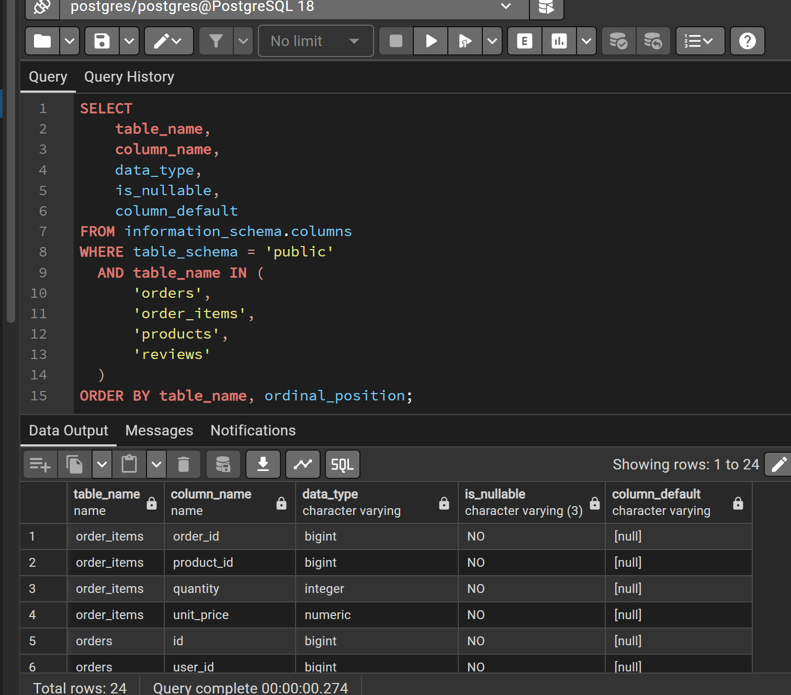

## 3. Задание 1. Работа с транзакциями

### 3.1. Успешная транзакция

Для демонстрации транзакции была выполнена последовательность связанных
действий: выбор пользователя, адреса и товара; создание заказа;
добавление позиции заказа; уменьшение остатка товара. Все операции
выполнялись в рамках одной транзакции.

``` sql
BEGIN;

DO $$
DECLARE
    v_user_id BIGINT;
    v_address_id BIGINT;
    v_product_id BIGINT;
    v_price NUMERIC(12,2);
    v_order_id BIGINT;
    v_quantity INT := 2;
BEGIN
    SELECT u.id, a.id
    INTO v_user_id, v_address_id
    FROM users u
    JOIN addresses a ON a.user_id = u.id
    ORDER BY u.id, a.id
    LIMIT 1;

    SELECT id, price
    INTO v_product_id, v_price
    FROM products
    WHERE is_active = TRUE
      AND stock_quantity >= v_quantity
    ORDER BY id
    LIMIT 1
    FOR UPDATE;

    IF v_user_id IS NULL OR v_product_id IS NULL THEN
        RAISE EXCEPTION 'Не найдены подходящие данные для заказа';
    END IF;

    INSERT INTO orders (user_id, shipping_address_id)
    VALUES (v_user_id, v_address_id)
    RETURNING id INTO v_order_id;

    INSERT INTO order_items (order_id, product_id, quantity, unit_price)
    VALUES (v_order_id, v_product_id, v_quantity, v_price);

    UPDATE products
    SET stock_quantity = stock_quantity - v_quantity
    WHERE id = v_product_id;

    RAISE NOTICE 'Создан заказ %, товар %, количество %',
        v_order_id, v_product_id, v_quantity;
END $$;

COMMIT;
```

В результате был создан заказ **№ 1001** для товара **№ 2** в количестве
**2 единиц**. Транзакция завершилась командой `COMMIT`.

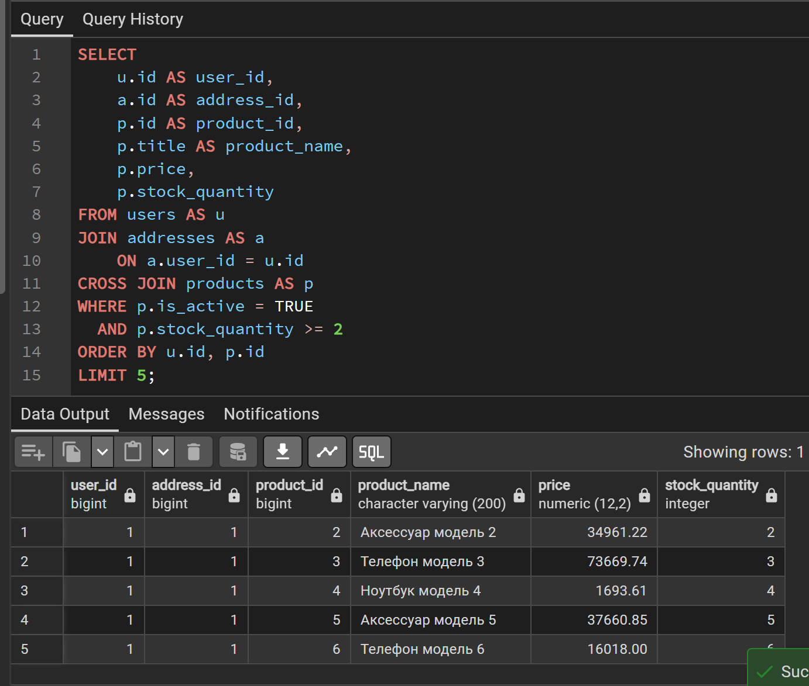

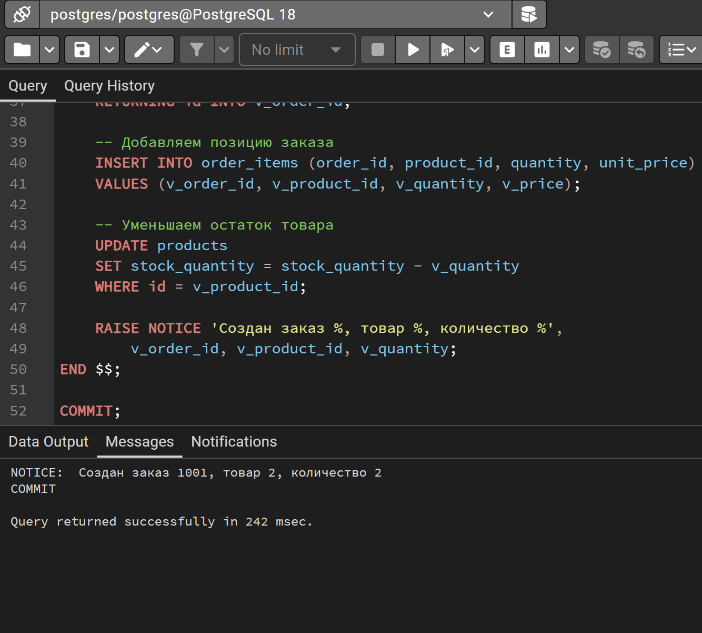

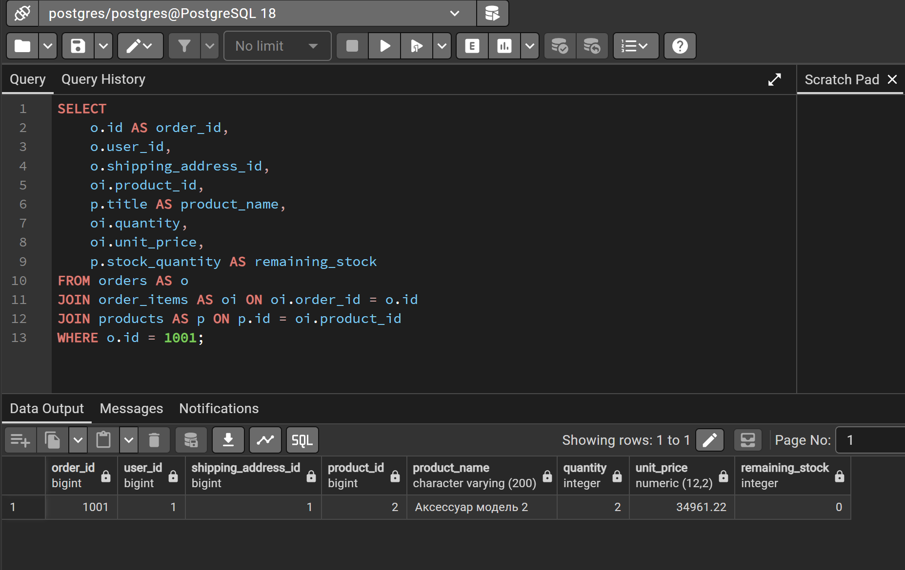

### 3.2. Транзакция с ошибкой

Затем была выполнена проверка сценария недостаточного остатка. Внутри
транзакции создавались заказ и позиция заказа, после чего выполнялась
проверка возможности списания заведомо большего количества товара. При
недостатке остатка генерировалось исключение.

``` sql
BEGIN;

DO $$
DECLARE
    v_user_id BIGINT;
    v_address_id BIGINT;
    v_product_id BIGINT;
    v_price NUMERIC(12,2);
    v_order_id BIGINT;
    v_quantity INT;
BEGIN
    SELECT u.id, a.id
    INTO v_user_id, v_address_id
    FROM users u
    JOIN addresses a ON a.user_id = u.id
    ORDER BY u.id, a.id
    LIMIT 1;

    SELECT id, price, stock_quantity
    INTO v_product_id, v_price, v_quantity
    FROM products
    WHERE is_active = TRUE
    ORDER BY id
    LIMIT 1
    FOR UPDATE;

    INSERT INTO orders (user_id, shipping_address_id)
    VALUES (v_user_id, v_address_id)
    RETURNING id INTO v_order_id;

    INSERT INTO order_items (order_id, product_id, quantity, unit_price)
    VALUES (v_order_id, v_product_id, v_quantity, v_price);

    UPDATE products
    SET stock_quantity = stock_quantity - (v_quantity + 100)
    WHERE id = v_product_id
      AND stock_quantity >= v_quantity + 100;

    IF NOT FOUND THEN
        RAISE EXCEPTION 'Недостаточно товара на складе!';
    END IF;
END $$;
```

При выполнении возникла ожидаемая ошибка
`Недостаточно товара на складе!`. После ошибки pgAdmin показал
предупреждение `there is no transaction in progress` при отдельном
выполнении `ROLLBACK`. Это означает, что к моменту команды активной
транзакции уже не было --- она была отменена или закрыта
обработчиком/средой выполнения. Само предупреждение не является
подтверждением того, что именно эта команда выполнила откат.

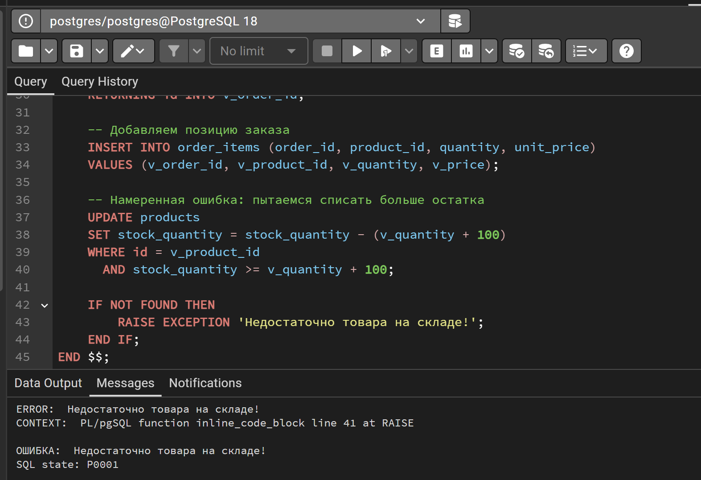

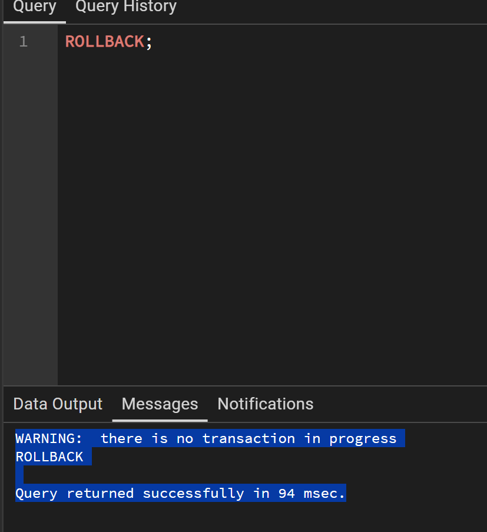

**Пояснение:** PostgreSQL использует последовательности для генерации
идентификаторов. Значения последовательностей не возвращаются назад при
откате транзакции. Поэтому пропуск номера заказа не означает, что
неудачный заказ сохранился.

## 4. Задание 2. Функция оформления заказа

Создана функция `place_order`, которая принимает идентификаторы
пользователя, адреса и товара, а также количество товара. Функция
проверяет корректность количества, наличие активного товара и
достаточность остатка. Строка товара блокируется через `FOR UPDATE`,
чтобы предотвратить конкурентное списание одного и того же остатка.

``` sql
CREATE OR REPLACE FUNCTION place_order(
    p_user_id BIGINT,
    p_address_id BIGINT,
    p_product_id BIGINT,
    p_quantity INT
)
RETURNS BIGINT
LANGUAGE plpgsql
AS $$
DECLARE
    v_price NUMERIC(12,2);
    v_stock INT;
    v_order_id BIGINT;
BEGIN
    IF p_quantity <= 0 THEN
        RAISE EXCEPTION 'Количество товара должно быть больше нуля';
    END IF;

    SELECT price, stock_quantity
    INTO v_price, v_stock
    FROM products
    WHERE id = p_product_id
      AND is_active = TRUE
    FOR UPDATE;

    IF NOT FOUND THEN
        RAISE EXCEPTION 'Товар не найден или неактивен';
    END IF;

    IF v_stock < p_quantity THEN
        RAISE EXCEPTION
            'Недостаточно товара на складе. Остаток: %, запрошено: %',
            v_stock, p_quantity;
    END IF;

    INSERT INTO orders (user_id, shipping_address_id)
    VALUES (p_user_id, p_address_id)
    RETURNING id INTO v_order_id;

    INSERT INTO order_items (order_id, product_id, quantity, unit_price)
    VALUES (v_order_id, p_product_id, p_quantity, v_price);

    UPDATE products
    SET stock_quantity = stock_quantity - p_quantity
    WHERE id = p_product_id;

    RETURN v_order_id;
END;
$$;
```

Вызов функции:

``` sql
SELECT place_order(
    (SELECT id FROM users ORDER BY id LIMIT 1),
    (SELECT id FROM addresses ORDER BY id LIMIT 1),
    (SELECT id FROM products
     WHERE is_active = TRUE AND stock_quantity >= 1
     ORDER BY id LIMIT 1),
    1
) AS new_order_id;
```

Функция успешно выполнилась и вернула идентификатор нового заказа
**1003**. Затем был выполнен запрос проверки заказа, его позиции и
остатка товара.

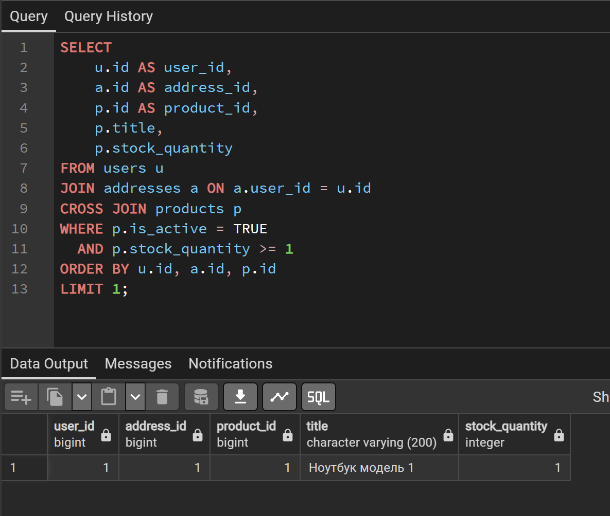

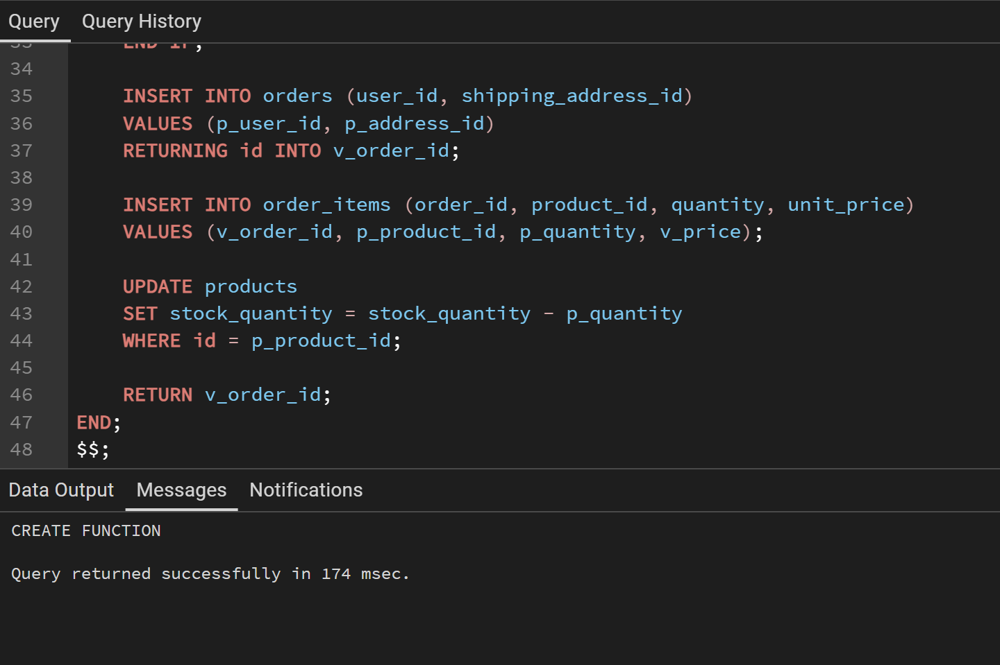

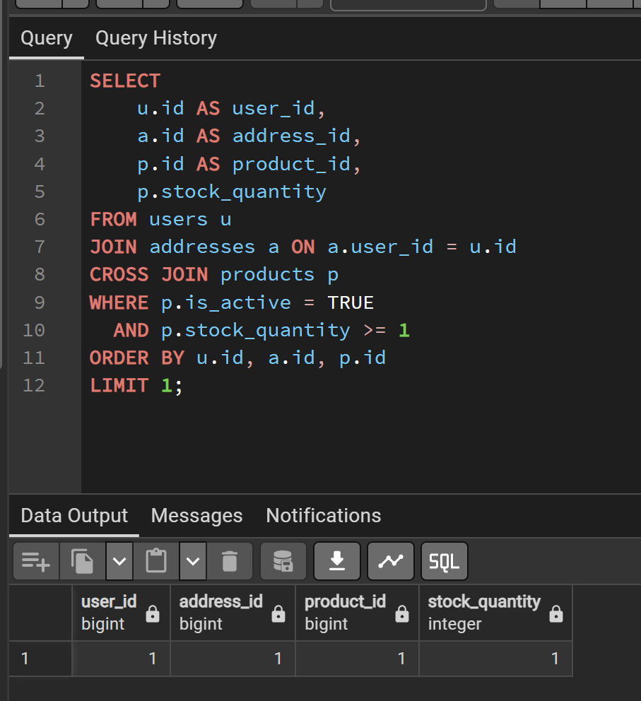

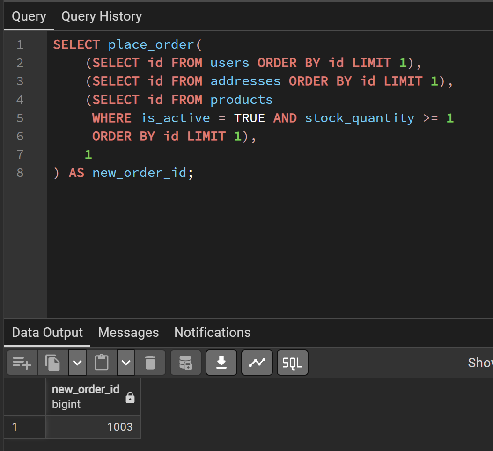

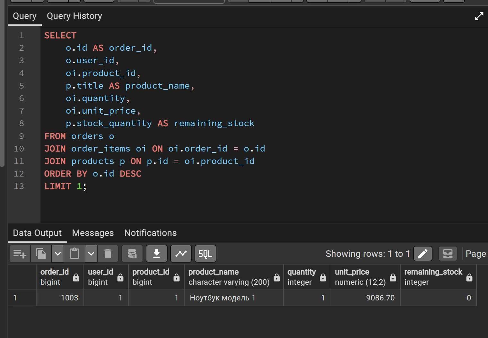

## 5. Задание 3. Функция расчёта выручки продавца

Создана функция `seller_revenue`, которая принимает ID продавца и
границы периода. Выручка рассчитывается как сумма произведений
количества товара на цену позиции заказа. Для исключения `NULL`
используется `COALESCE`.

``` sql
CREATE OR REPLACE FUNCTION seller_revenue(
    p_seller_id BIGINT,
    p_date_from DATE,
    p_date_to DATE
)
RETURNS NUMERIC(14,2)
LANGUAGE plpgsql
AS $$
DECLARE
    v_revenue NUMERIC(14,2);
BEGIN
    SELECT COALESCE(SUM(oi.quantity * oi.unit_price), 0)
    INTO v_revenue
    FROM order_items oi
    JOIN orders o ON o.id = oi.order_id
    JOIN products p ON p.id = oi.product_id
    WHERE p.seller_id = p_seller_id
      AND o.created_at::DATE BETWEEN p_date_from AND p_date_to;

    RETURN v_revenue;
END;
$$;
```

Проверочный вызов для первого продавца за октябрь 2026 года:

``` sql
SELECT seller_revenue(
    (SELECT id FROM sellers ORDER BY id LIMIT 1),
    DATE '2026-10-01',
    DATE '2026-10-31'
) AS seller_revenue;
```

Полученный результат: **1 263 843,85**.

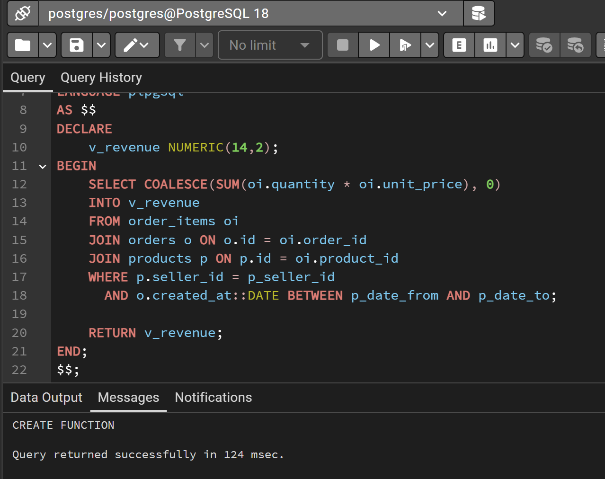

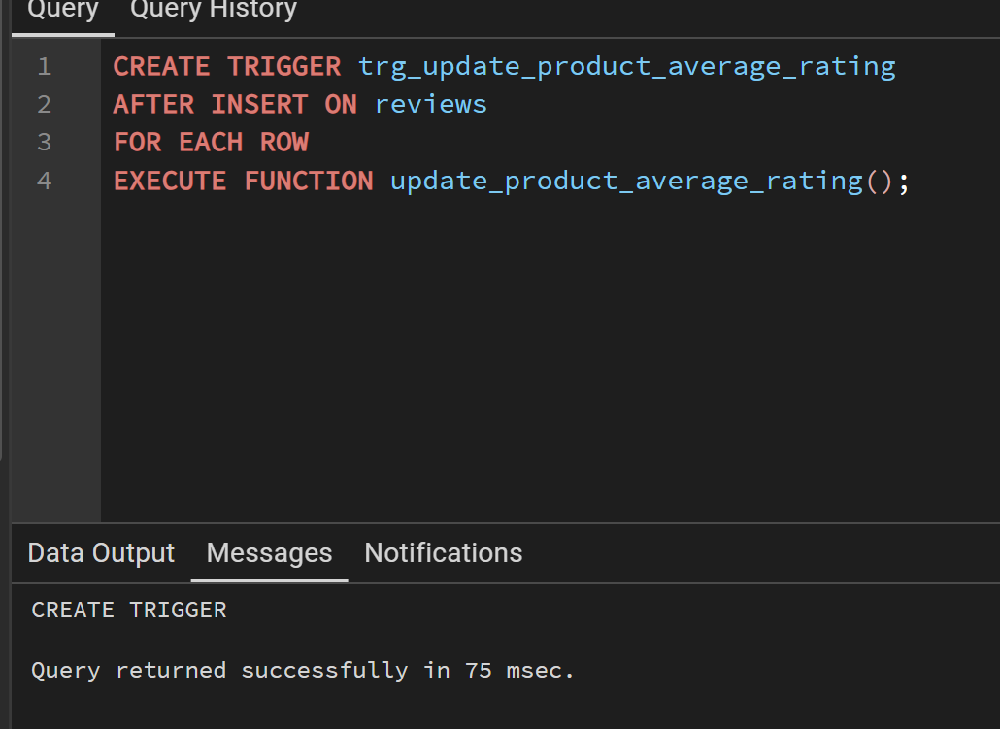

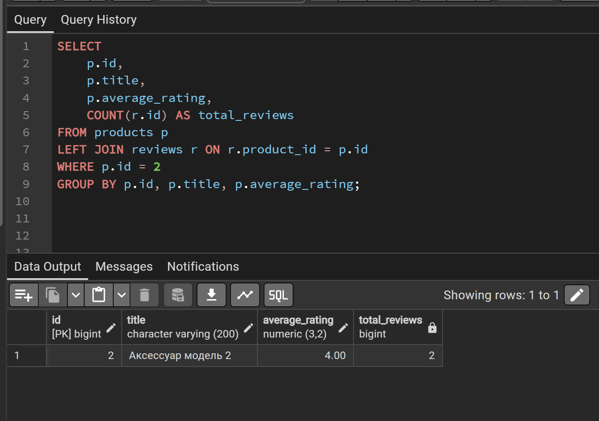

## 6. Задание 4. Аудит изменения цены товара

Для хранения истории изменения цен создана таблица
`product_price_audit`.

``` sql
CREATE TABLE IF NOT EXISTS product_price_audit (
    id BIGSERIAL PRIMARY KEY,
    product_id BIGINT REFERENCES products(id),
    old_price NUMERIC(12,2),
    new_price NUMERIC(12,2),
    changed_at TIMESTAMP DEFAULT CURRENT_TIMESTAMP
);
```

Создана триггерная функция. Она сравнивает старое и новое значение цены
и записывает изменение в журнал только в том случае, если цена
действительно изменилась.

``` sql
CREATE OR REPLACE FUNCTION log_product_price_change()
RETURNS TRIGGER
LANGUAGE plpgsql
AS $$
BEGIN
    IF NEW.price IS DISTINCT FROM OLD.price THEN
        INSERT INTO product_price_audit (
            product_id,
            old_price,
            new_price
        )
        VALUES (
            OLD.id,
            OLD.price,
            NEW.price
        );
    END IF;

    RETURN NEW;
END;
$$;
```

Триггер подключён к обновлению столбца `price`:

``` sql
CREATE TRIGGER trg_product_price_audit
AFTER UPDATE OF price ON products
FOR EACH ROW
EXECUTE FUNCTION log_product_price_change();
```

Для проверки цена товара с ID 2 была увеличена на одну денежную единицу:

``` sql
UPDATE products
SET price = price + 1
WHERE id = 2;
```

В журнале появилась запись: старая цена --- **34 961,22**, новая цена
--- **34 962,22**. Это подтверждает работу аудита.

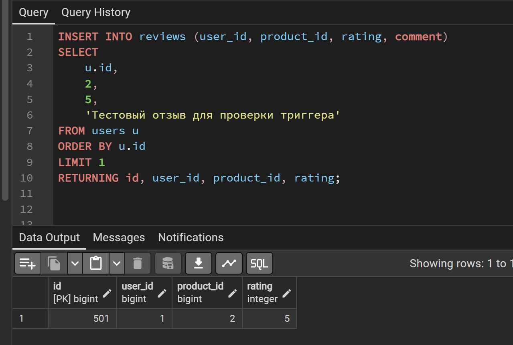

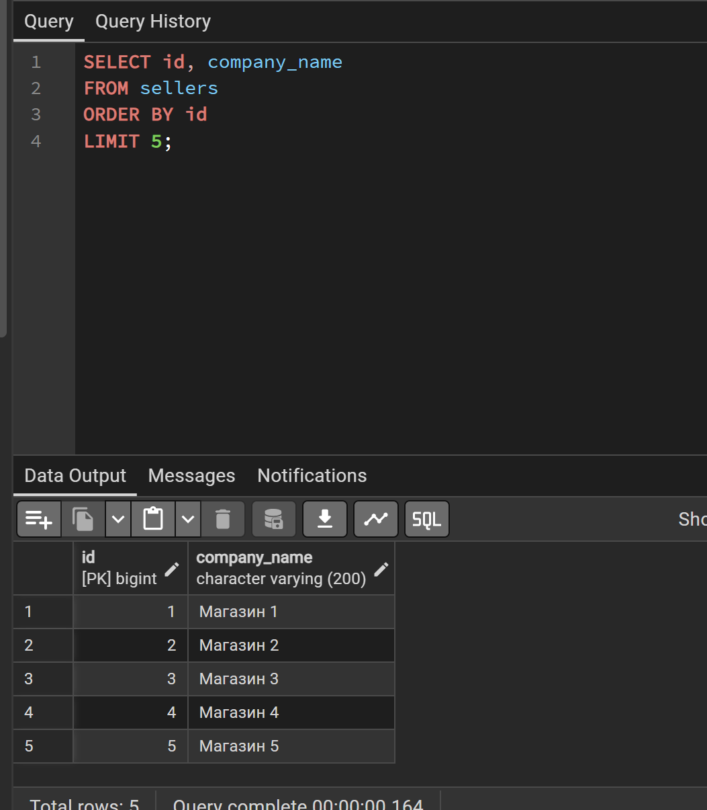

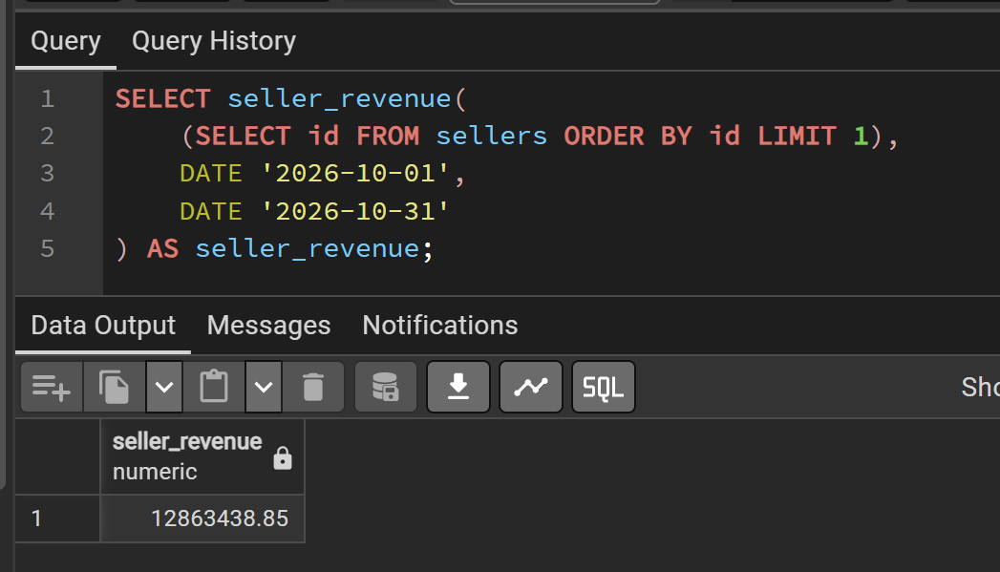

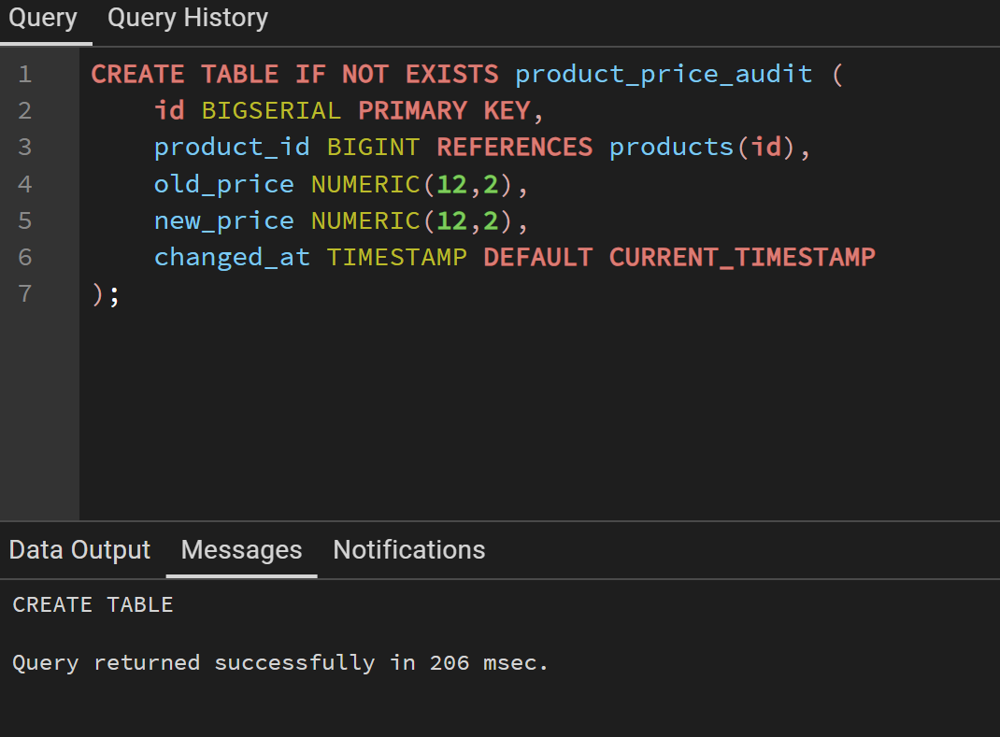

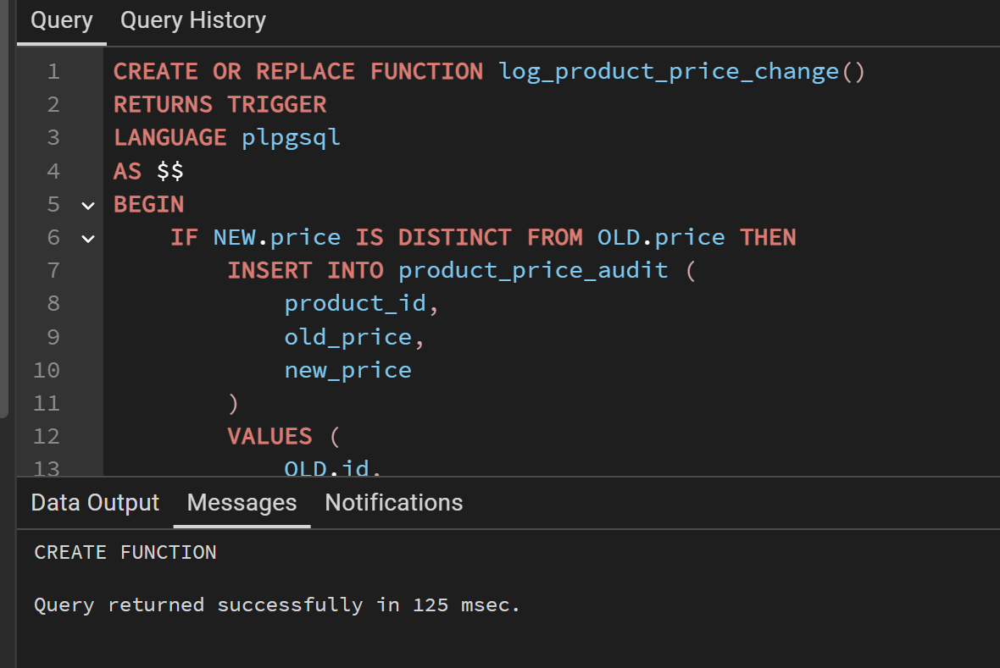

## 7. Задание 5. Автоматический пересчёт среднего рейтинга товара

В таблицу `products` добавлено поле `average_rating`, предназначенное
для хранения среднего рейтинга товара.

``` sql
ALTER TABLE products
ADD COLUMN IF NOT EXISTS average_rating NUMERIC(3,2);
```

Создана функция, которая после добавления отзыва рассчитывает среднее
значение `reviews.rating` для соответствующего товара и обновляет
`products.average_rating`.

``` sql
CREATE OR REPLACE FUNCTION update_product_average_rating()
RETURNS TRIGGER
LANGUAGE plpgsql
AS $$
BEGIN
    UPDATE products
    SET average_rating = (
        SELECT ROUND(AVG(rating)::NUMERIC, 2)
        FROM reviews
        WHERE product_id = NEW.product_id
    )
    WHERE id = NEW.product_id;

    RETURN NEW;
END;
$$;
```

Создан триггер `AFTER INSERT`:

``` sql
CREATE TRIGGER trg_update_product_average_rating
AFTER INSERT ON reviews
FOR EACH ROW
EXECUTE FUNCTION update_product_average_rating();
```

Для проверки был добавлен тестовый отзыв с оценкой 5 для товара № 2:

``` sql
INSERT INTO reviews (user_id, product_id, rating, comment)
SELECT
    u.id,
    2,
    5,
    'Тестовый отзыв для проверки триггера'
FROM users u
ORDER BY u.id
LIMIT 1
RETURNING id, user_id, product_id, rating;
```

Проверка результата:

``` sql
SELECT
    p.id,
    p.title,
    p.average_rating,
    COUNT(r.id) AS total_reviews
FROM products p
LEFT JOIN reviews r ON r.product_id = p.id
WHERE p.id = 2
GROUP BY p.id, p.title, p.average_rating;
```

По результату проверки средний рейтинг товара № 2 составил **4,00**,
количество отзывов --- **2**. Это подтверждает автоматический пересчёт
после вставки отзыва.

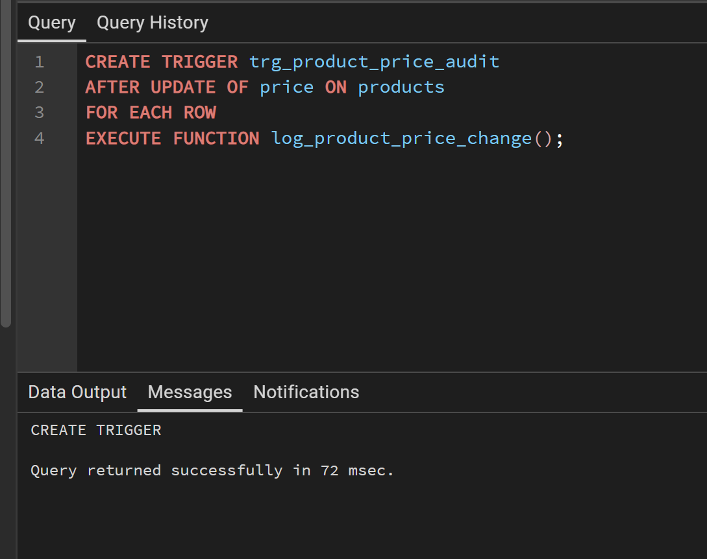

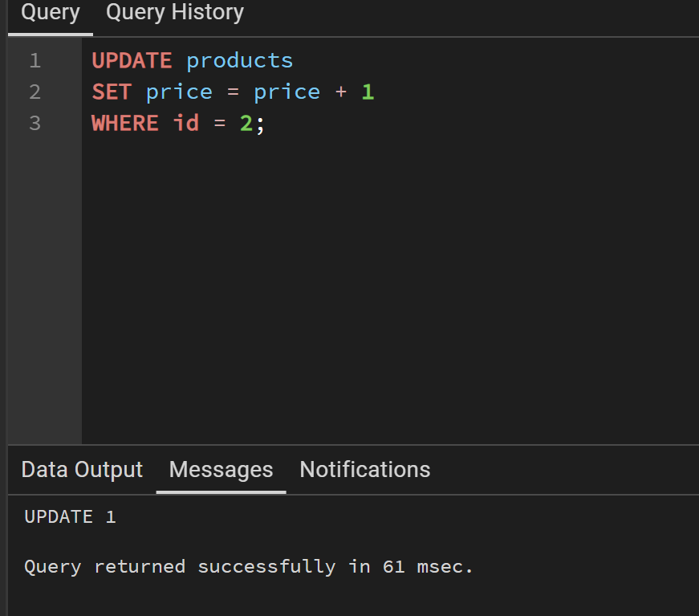

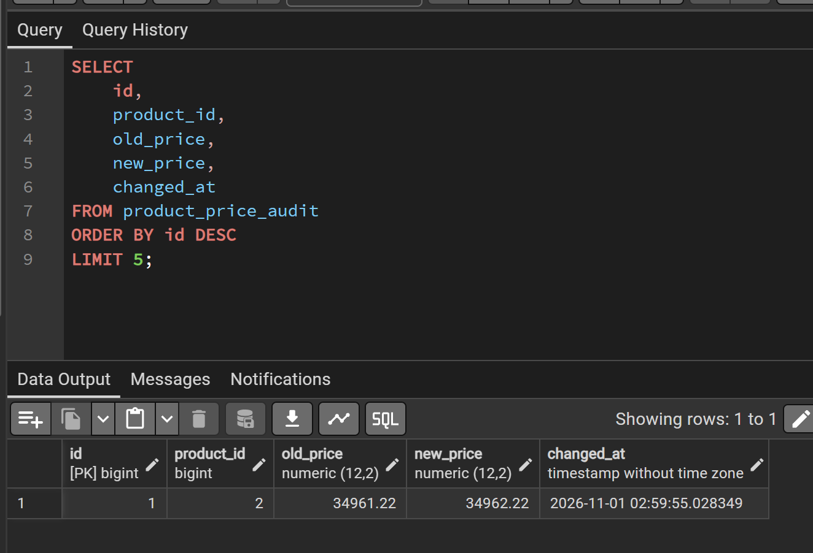

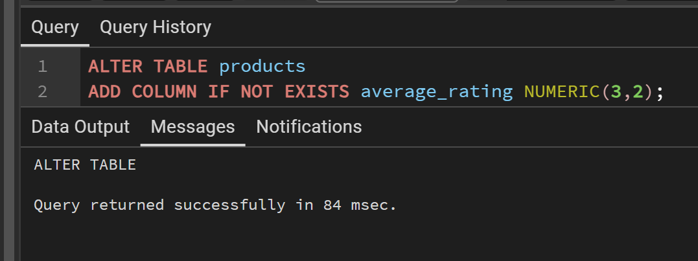

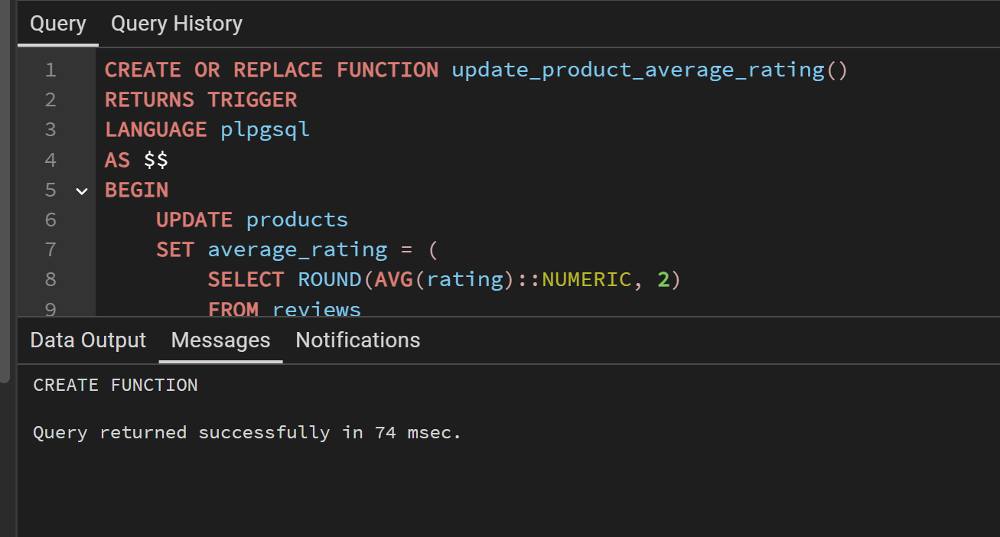

**Ограничение реализации:** триггер настроен на событие `INSERT`.
Изменение или удаление уже существующего отзыва автоматически средний
рейтинг не пересчитывает. Для полного сопровождения рейтинга можно
расширить триггер на `UPDATE` и `DELETE`.

## 8. Задание 6. Разделение логики между базой данных и приложением

В ходе работы рассмотрено, какие задачи целесообразно выполнять на
стороне БД, а какие --- в приложении.

  -----------------------------------------------------------------------
  На стороне базы данных              На стороне приложения
  ----------------------------------- -----------------------------------
  Обеспечение целостности данных и    Отображение интерфейса
  ограничений                         

  Транзакции и атомарные операции     Обработка пользовательского ввода

  Хранимые функции для операций с     Навигация и логика экранов
  данными                             

  Триггеры аудита и автоматического   Уведомления и взаимодействие с
  пересчёта                           пользователем

  Контроль остатков и согласованности Представление результатов в удобном
  связанных записей                   виде
  -----------------------------------------------------------------------

**Вывод по заданию:** в базе данных следует размещать логику, которая
должна гарантированно обеспечивать целостность и согласованность данных
независимо от приложения. В приложении удобнее реализовывать
пользовательский интерфейс и сценарии взаимодействия с пользователем.

## 9. Контрольные вопросы

### 1. Что такое транзакция?

Транзакция --- это последовательность операций с базой данных, которая
рассматривается как единое целое. Она завершается подтверждением или
отменой изменений.

### 2. Для чего используются COMMIT и ROLLBACK?

`COMMIT` подтверждает изменения текущей транзакции. `ROLLBACK` отменяет
изменения текущей незавершённой транзакции.

### 3. Что такое SAVEPOINT?

`SAVEPOINT` создаёт промежуточную точку внутри транзакции. С помощью
`ROLLBACK TO SAVEPOINT` можно отменить часть операций, выполненных после
этой точки, не отменяя всю транзакцию.

### 4. Когда необходимо использовать транзакции?

Транзакции нужны, когда несколько связанных операций должны выполниться
согласованно. Например, при оформлении заказа необходимо одновременно
создать заказ, добавить его позиции и уменьшить остаток товара.

### 5. Что означает атомарность?

Атомарность означает принцип «всё или ничего»: либо все операции
транзакции успешно выполняются, либо изменения транзакции отменяются.

### 6. Что такое PL/pgSQL?

PL/pgSQL --- процедурный язык PostgreSQL, который расширяет SQL
переменными, условиями, циклами, обработкой исключений и возможностью
создавать функции.

### 7. Для чего используется RAISE EXCEPTION?

`RAISE EXCEPTION` генерирует ошибку в PL/pgSQL и прерывает выполнение
текущей функции или блока. Используется, например, при недостатке товара
на складе.

### 8. Что такое триггер?

Триггер --- это механизм автоматического выполнения триггерной функции
при наступлении заданного события, например `INSERT`, `UPDATE` или
`DELETE`.

### 9. Чем отличаются BEFORE и AFTER, а также NEW и OLD?

`BEFORE` запускается до выполнения изменения строки, `AFTER` --- после
него. `NEW` содержит новую версию строки, а `OLD` --- прежнюю версию
строки. Доступность этих записей зависит от типа события.

### 10. Для чего применяются триггеры и какие у них недостатки?

Триггеры применяются для аудита изменений, автоматического обновления
связанных данных и контроля бизнес-правил. Их недостатки --- скрытое
выполнение логики, усложнение отладки и сопровождения, а также возможное
влияние на производительность.

## 10. Общий вывод

В лабораторной работе были изучены транзакции PostgreSQL, механизмы
фиксации и отмены изменений, а также процедурный язык PL/pgSQL. Создана
функция оформления заказа с проверкой остатка товара и блокировкой
строки на время операции. Реализована функция расчёта выручки продавца
за заданный период.

Также создан журнал аудита изменения цены товара и триггер,
автоматически записывающий старое и новое значения цены. Для товаров
добавлено поле среднего рейтинга, которое пересчитывается триггером
после добавления нового отзыва.

В результате работы получены практические навыки создания транзакций,
хранимых функций и триггеров, а также понимание того, как распределять
серверную логику между базой данных и приложением.
