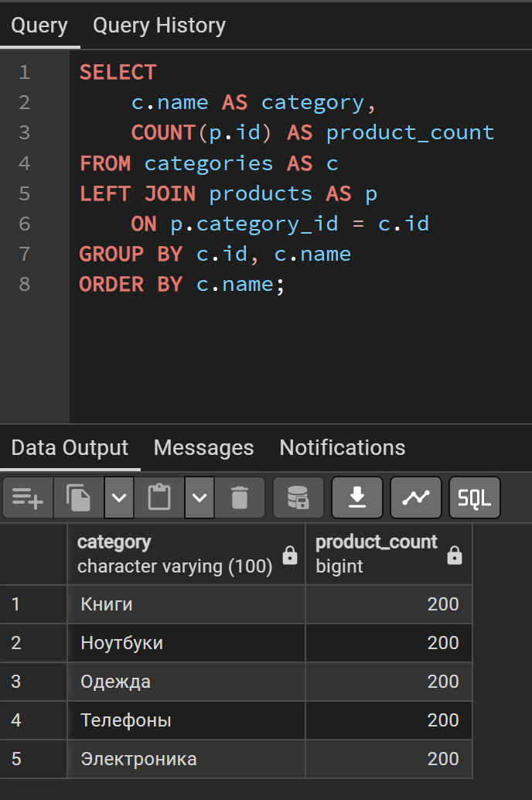
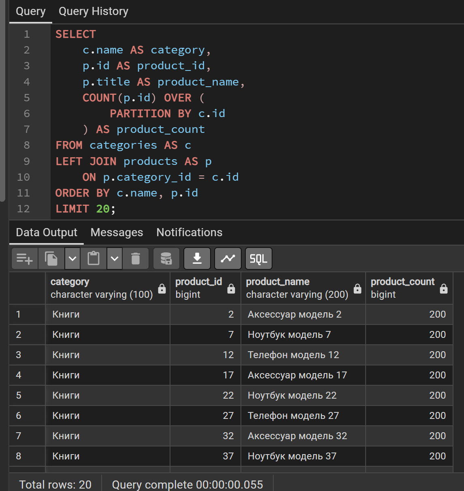

# Лабораторная работа № 4

## Оконные функции и аналитика данных

**Цель работы:** изучить оконные функции SQL и научиться применять их
для ранжирования, выбора лучших записей в группах, расчёта накопительных
итогов, долей выручки и сравнения значений соседних строк.

**Среда выполнения:** PostgreSQL, pgAdmin.

## 1. Рейтинг товаров по цене внутри категории

Для каждого товара рассчитаны три вида ранга: `ROW_NUMBER()`, `RANK()` и
`DENSE_RANK()`. Разделение выполняется по категории, а сортировка --- по
цене от большей к меньшей.

``` sql
SELECT
    c.name AS category,
    p.title AS product_name,
    p.price,
    ROW_NUMBER() OVER w AS row_num,
    RANK() OVER w AS price_rank,
    DENSE_RANK() OVER w AS dense_rank
FROM products AS p
JOIN categories AS c
    ON c.id = p.category_id
WINDOW w AS (
    PARTITION BY p.category_id
    ORDER BY p.price DESC
)
ORDER BY c.name, row_num;
```

**Результат:** запрос выполнился успешно и вернул 30 строк (по данным
истории выполнения). На скриншоте видны все три столбца ранжирования.


**Пояснение различий:** - `ROW_NUMBER()` назначает каждой строке
отдельный последовательный номер, даже если цены совпадают. - `RANK()`
присваивает одинаковым ценам одинаковый ранг, а следующий ранг может
иметь пропуск. - `DENSE_RANK()` также присваивает одинаковым ценам
одинаковый ранг, но пропусков не создаёт.

В показанной части результата ранги идут последовательно. Если в таблице
есть товары с одинаковой ценой, различие между `RANK()` и `DENSE_RANK()`
проявится на таких строках.

## 2. Три самых дорогих товара в каждой категории

Сначала товары нумеруются внутри каждой категории по убыванию цены.
Затем внешний запрос оставляет позиции с номером не больше трёх.

``` sql
WITH ranked_products AS (
    SELECT
        p.category_id,
        c.name AS category_name,
        p.title AS product_name,
        p.price,
        ROW_NUMBER() OVER (
            PARTITION BY p.category_id
            ORDER BY p.price DESC
        ) AS rn
    FROM products AS p
    JOIN categories AS c
        ON c.id = p.category_id
)
SELECT
    category_name,
    product_name,
    price,
    rn AS position
FROM ranked_products
WHERE rn <= 3
ORDER BY category_id, rn;
```

**Результат:** запрос выполнен. На скриншоте представлены товары с
позициями 1--3 внутри категорий. Число строк в результате зависит от
количества категорий и наличия товаров; в предоставленном скриншоте
видны строки для нескольких категорий.


**Вывод:** CTE позволяет сначала вычислить номер товара в своей
категории, а затем отфильтровать рассчитанный номер во внешнем запросе.
Оконную функцию нельзя напрямую отфильтровать в `WHERE` того же уровня
запроса, где она вычисляется, поэтому используется CTE.

## 3. Нарастающий итог выручки по дням

На первом этапе считается дневная выручка, затем оконная сумма
накапливает её в порядке дат.

``` sql
WITH daily_revenue AS (
    SELECT
        o.created_at::date AS day,
        SUM(oi.quantity * oi.unit_price) AS day_revenue
    FROM orders AS o
    JOIN order_items AS oi
        ON oi.order_id = o.id
    GROUP BY o.created_at::date
)
SELECT
    day,
    day_revenue,
    SUM(day_revenue) OVER (
        ORDER BY day
        ROWS BETWEEN UNBOUNDED PRECEDING AND CURRENT ROW
    ) AS running_total
FROM daily_revenue
ORDER BY day;
```

**Результат:** запрос выполнен и вернул одну строку. На скриншоте для
даты `2026-10-13` дневная выручка и накопительный итог равны
`135740352.30`.


Дополнительно была выполнена проверка диапазона дат:

``` sql
SELECT
    COUNT(DISTINCT created_at::date) AS days_with_orders,
    MIN(created_at::date) AS first_order_date,
    MAX(created_at::date) AS last_order_date
FROM orders;
```

Проверка показала, что в таблице `orders` имеется **одна уникальная
дата**: `2026-10-13`. Следовательно, запрос накопительного итога
работает корректно, но по имеющимся данным нельзя увидеть изменение
накопленной суммы между несколькими днями.


## 4. Доля выручки продавца в выручке категории

В CTE рассчитывается выручка каждого продавца в каждой категории. Затем
`SUM(revenue) OVER (PARTITION BY category_id)` вычисляет общую выручку
категории, не сворачивая строки продавцов.

``` sql
WITH seller_category_revenue AS (
    SELECT
        p.category_id,
        c.name AS category_name,
        s.id AS seller_id,
        s.company_name AS seller_name,
        SUM(oi.quantity * oi.unit_price) AS revenue
    FROM products AS p
    JOIN categories AS c
        ON c.id = p.category_id
    JOIN sellers AS s
        ON s.id = p.seller_id
    JOIN order_items AS oi
        ON oi.product_id = p.id
    GROUP BY
        p.category_id,
        c.name,
        s.id,
        s.company_name
)
SELECT
    category_name,
    seller_name,
    revenue,
    ROUND(
        100.0 * revenue /
        NULLIF(SUM(revenue) OVER (PARTITION BY category_id), 0),
        2
    ) AS category_revenue_share_pct
FROM seller_category_revenue
ORDER BY category_name, revenue DESC;
```

**Результат:** запрос выполнен успешно, получено 10 строк. На скриншоте
присутствуют категория, продавец, выручка и доля выручки в процентах.


`NULLIF(..., 0)` предотвращает деление на ноль. Доли продавцов внутри
одной категории в сумме должны составлять примерно 100%; возможна
небольшая разница из-за округления.

## 5. Сравнение выручки с предыдущим и следующим днём

Сначала рассчитывается выручка по дням. Затем `LAG()` возвращает выручку
предыдущей строки, а `LEAD()` --- следующей строки в порядке дат.

``` sql
WITH daily_revenue AS (
    SELECT
        o.created_at::date AS day,
        SUM(oi.quantity * oi.unit_price) AS day_revenue
    FROM orders AS o
    JOIN order_items AS oi
        ON oi.order_id = o.id
    GROUP BY o.created_at::date
),
comparisons AS (
    SELECT
        day,
        day_revenue,
        LAG(day_revenue) OVER (ORDER BY day) AS previous_day_revenue,
        LEAD(day_revenue) OVER (ORDER BY day) AS next_day_revenue
    FROM daily_revenue
)
SELECT
    day,
    day_revenue,
    previous_day_revenue,
    next_day_revenue,
    day_revenue - previous_day_revenue AS change_vs_previous_day
FROM comparisons
ORDER BY day;
```

**Результат:** запрос выполнен и вернул одну строку. Значения
`previous_day_revenue`, `next_day_revenue` и `change_vs_previous_day`
равны `NULL`, поскольку в выборке только одна дата и соседних строк нет.


Это ожидаемое поведение, а не ошибка запроса. Для содержательного
сравнения необходимо иметь заказы хотя бы за несколько разных дат.

## 6. Сравнение `GROUP BY` и оконной функции

### Вариант 1 --- группировка

``` sql
SELECT
    c.name AS category,
    COUNT(p.id) AS product_count
FROM categories AS c
LEFT JOIN products AS p
    ON p.category_id = c.id
GROUP BY c.id, c.name
ORDER BY c.name;
```

Запрос возвращает по одной строке на категорию. На скриншоте получено 5
строк; для каждой из пяти категорий показано количество товаров `200`.



### Вариант 2 --- оконная функция

``` sql
SELECT
    c.name AS category,
    p.id AS product_id,
    p.title AS product_name,
    COUNT(p.id) OVER (
        PARTITION BY c.id
    ) AS product_count
FROM categories AS c
LEFT JOIN products AS p
    ON p.category_id = c.id
ORDER BY c.name, p.id
LIMIT 20;
```

**Результат:** запрос вернул 20 строк из-за `LIMIT 20`. В каждой
показанной строке количество товаров в соответствующей категории равно
`200`.



**Сравнение:** `GROUP BY` сворачивает товары в одну строку на категорию,
а `COUNT() OVER (PARTITION BY ...)` сохраняет строки отдельных товаров и
добавляет к каждой строке общее количество товаров в её категории.
Поэтому оконная функция удобнее, когда требуется одновременно видеть
детальные данные и сводную характеристику группы.

## Ответы на контрольные вопросы

### 1. Что такое оконная функция и чем она отличается от `GROUP BY`?

Оконная функция вычисляет значение по набору строк, связанному с текущей
строкой, но сохраняет строки результата. `GROUP BY` объединяет строки в
группы и возвращает итоговые строки по группам.

### 2. За что отвечает конструкция `OVER`?

`OVER` определяет окно, по которому вычисляется функция. Внутри него
можно задать разделение на группы через `PARTITION BY`, порядок через
`ORDER BY` и рамку окна через `ROWS` или `RANGE`.

### 3. Что задаёт `PARTITION BY` и чем она похожа и непохожа на `GROUP BY`?

`PARTITION BY` делит строки на независимые разделы для оконного
вычисления. Как и `GROUP BY`, она группирует строки по указанным
значениям, но не сворачивает строки в одну запись на группу.

### 4. Для чего нужна секция `ORDER BY` внутри `OVER`?

Она задаёт порядок строк для ранжирования, накопительных итогов и
функций смещения, таких как `LAG()` и `LEAD()`.

### 5. Чем различаются `ROW_NUMBER`, `RANK` и `DENSE_RANK`?

`ROW_NUMBER()` выдаёт каждой строке уникальный последовательный номер.
`RANK()` присваивает одинаковым значениям одинаковый ранг и пропускает
номера после совпадений. `DENSE_RANK()` также присваивает одинаковым
значениям одинаковый ранг, но не пропускает следующие номера.

### 6. Как отобрать N лучших строк в каждой группе?

Нужно вычислить `ROW_NUMBER()` с `PARTITION BY` и сортировкой по
критерию отбора, поместить результат в CTE или подзапрос, а затем во
внешнем запросе применить фильтр, например `WHERE rn <= 3`.

### 7. Как использовать агрегатную функцию в роли оконной?

К агрегатной функции добавляют `OVER`, например
`SUM(value) OVER (PARTITION BY group_id)`. Результат агрегата
показывается рядом с исходными строками, а не вместо них.

### 8. Что такое нарастающий итог и как его получить?

Нарастающий итог --- сумма значений от начала упорядоченной
последовательности до текущей строки. Например:

``` sql
SUM(day_revenue) OVER (
    ORDER BY day
    ROWS BETWEEN UNBOUNDED PRECEDING AND CURRENT ROW
)
```

### 9. Что делают `LAG` и `LEAD`?

`LAG()` возвращает значение из предыдущей строки окна, а `LEAD()` --- из
следующей. Их используют для сравнения периодов, вычисления изменений и
анализа последовательностей.

### 10. Когда оконная функция предпочтительнее обычной группировки?

Когда нужно сохранить подробные строки и одновременно показать
аналитический показатель по группе: ранг, долю, сумму, количество или
накопительный итог.

## Общий вывод

В ходе лабораторной работы были изучены и применены оконные функции
PostgreSQL: `ROW_NUMBER()`, `RANK()`, `DENSE_RANK()`, `SUM() OVER`,
`COUNT() OVER`, `LAG()` и `LEAD()`. С помощью CTE реализован выбор трёх
самых дорогих товаров в каждой категории, рассчитаны доли выручки
продавцов и выполнено сравнение оконного вычисления с `GROUP BY`.

По приложенным скриншотам выполнение запросов в целом соответствует
ожидаемому результату. Есть два ограничения данных, которые важно
указать в отчёте:

1.  В таблице заказов присутствует только одна дата (`2026-10-13`),
    поэтому накопительный итог состоит из одной точки, а `LAG()` и
    `LEAD()` возвращают `NULL`.
2.  В обоих вариантах задания 6 показано по 200 товаров в каждой
    категории. Результаты двух запросов согласуются между собой, хотя
    при необходимости это распределение можно дополнительно проверить
    отдельным запросом.

Таким образом, все шесть заданий выполнены; временная аналитика
технически корректна, но для демонстрации изменений по дням нужны данные
с несколькими датами.
