# Лабораторная работа № 6
## Современные возможности PostgreSQL и оптимизация запросов

**Тема:** работа с типом `JSONB`, анализ планов выполнения запросов, создание B-tree- и GIN-индексов, оценка влияния индексов на чтение и вставку данных.

---

## 1. Цель работы

Изучить современные возможности PostgreSQL и практические способы оптимизации запросов: хранение слабоструктурированных данных в `JSONB`, извлечение и фильтрация JSON-значений, анализ планов с помощью `EXPLAIN ANALYZE`, создание индексов и сравнение производительности операций чтения и вставки.

## 2. Используемая среда и структура данных

Работа выполнялась в PostgreSQL через pgAdmin на базе данных маркетплейса. В запросах использовались таблицы:

- `products` — товары, их категории, продавцы, цены и характеристики;
- `categories` — категории товаров;
- `sellers` — продавцы;
- `orders` — заказы и даты их создания;
- `order_items` — позиции заказов, количество и цена товара.

## 3. Ход выполнения работы

### Задание 1. Добавление JSONB-атрибутов товарам

Для хранения характеристик товаров был добавлен столбец `attributes` типа `JSONB`. Такой формат удобен, когда набор характеристик зависит от вида товара и заранее не совпадает для всех категорий.

```sql
ALTER TABLE products
ADD COLUMN IF NOT EXISTS attributes JSONB;
```

Далее характеристики были заполнены для нескольких товаров с учётом их назначения. В ходе проверки было замечено, что первоначальные характеристики отдельных товаров не соответствовали их названиям. Данные были исправлены: для ноутбука указаны процессор, оперативная память, накопитель и диагональ экрана; для аксессуара — тип, материал, цвет и совместимость; для телефона — цвет, память, оперативная память, диагональ и ёмкость аккумулятора.

```sql
UPDATE products
SET attributes = '{
    "color": "black",
    "processor": "Intel Core i5",
    "ram": "16GB",
    "storage": "512GB SSD",
    "screen": "15.6"
}'::jsonb
WHERE id = 7;

UPDATE products
SET attributes = '{
    "type": "защитный чехол",
    "material": "silicone",
    "color": "transparent",
    "compatibility": "универсальный"
}'::jsonb
WHERE id = 8;

UPDATE products
SET attributes = '{
    "color": "white",
    "memory": "128GB",
    "ram": "8GB",
    "screen": "6.5",
    "battery": "5000mAh"
}'::jsonb
WHERE id = 9;
```

Проверка заполненных данных:

```sql
SELECT id, title, attributes
FROM products
WHERE id IN (7, 8, 9)
ORDER BY id;
```

**Результат и пояснение.** Столбец `JSONB` позволяет хранить разные наборы характеристик в одной таблице без добавления отдельного столбца под каждое возможное свойство. При этом устойчивые данные — идентификатор, цена, категория и продавец — остаются обычными реляционными столбцами.


### Задание 2. Извлечение и фильтрация значений JSONB

Для работы с полями JSONB были проверены операторы `->`, `->>` и `@>`, а также оператор `?` для проверки наличия ключа.

**Оператор `->` — извлечение значения в формате JSONB:**

```sql
SELECT
    id,
    title,
    attributes -> 'color' AS color,
    attributes -> 'ram' AS ram
FROM products
WHERE attributes IS NOT NULL
ORDER BY id;
```

**Оператор `->>` — извлечение значения как текста:**

```sql
SELECT
    id,
    title,
    attributes ->> 'color' AS color,
    attributes ->> 'ram' AS ram
FROM products
WHERE attributes ? 'color'
ORDER BY id;
```

**Оператор `@>` — проверка вхождения JSON-фрагмента:**

```sql
SELECT id, title, attributes
FROM products
WHERE attributes @> '{"color": "black"}'::jsonb;
```

**Пояснение.**

- `attributes -> 'color'` возвращает JSONB-значение. Например, строка будет представлена как JSON-строка с кавычками.
- `attributes ->> 'color'` возвращает обычный SQL-текст.
- `attributes ? 'color'` проверяет, существует ли ключ `color` на верхнем уровне JSONB-объекта.
- `attributes @> '{"color": "black"}'::jsonb` выбирает документы, содержащие указанный фрагмент.


### Задание 3. Анализ исходных планов выполнения запросов

Для оценки работы PostgreSQL до добавления нового составного индекса были исследованы два запроса. `EXPLAIN ANALYZE` не только показывает предполагаемый план, но и реально выполняет запрос, выводя фактическое время и количество обработанных строк.

#### 3.1. Выборка товаров по категории и цене

```sql
EXPLAIN ANALYZE
SELECT title, price
FROM products
WHERE category_id = 5
  AND price < 3000;
```

На исходном плане PostgreSQL использовал уже существующий индекс `idx_products_category_id` для отбора по `category_id`, после чего применил дополнительный фильтр по `price`. В плане видны `Bitmap Index Scan` по `idx_products_category_id` и `Bitmap Heap Scan` по таблице `products`. После индексного отбора было проверено условие цены; 194 строки не прошли фильтр, а итоговая выборка содержала 6 строк.

<figure>
  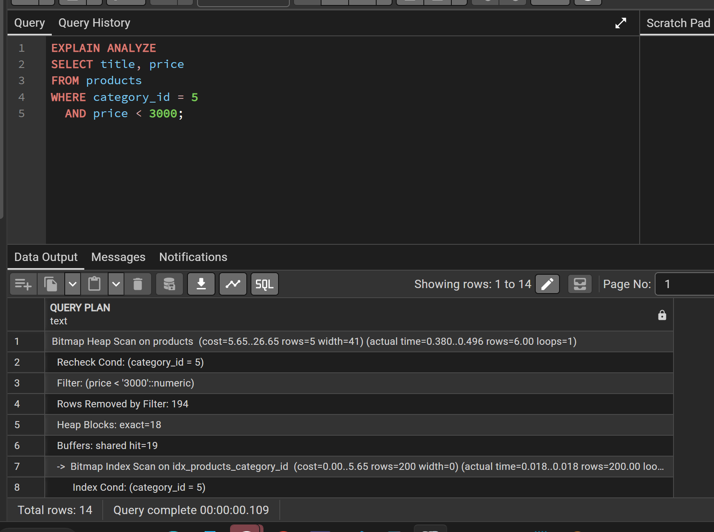
  <figcaption>Рисунок 1 — исходный план выборки товаров по категории и цене.</figcaption>
</figure>

#### 3.2. Расчёт выручки продавца за период

```sql
EXPLAIN ANALYZE
SELECT
    p.seller_id,
    COALESCE(SUM(oi.quantity * oi.unit_price), 0) AS revenue
FROM orders o
JOIN order_items oi ON oi.order_id = o.id
JOIN products p ON p.id = oi.product_id
WHERE p.seller_id = (SELECT MIN(id) FROM sellers)
  AND o.created_at >= DATE '2026-10-01'
  AND o.created_at < DATE '2026-11-01'
GROUP BY p.seller_id;
```

Запрос соединяет заказы, позиции заказов и товары, фильтрует данные по продавцу и диапазону дат, затем суммирует произведение количества на цену. `COALESCE` заменяет `NULL` на ноль, если агрегатное выражение вернёт `NULL`.

В исходном плане присутствуют `Seq Scan` для `orders` и `order_items`, `Bitmap Index Scan` по существующему индексу продавца в `products`, а также `Hash Join` для соединения таблиц. Полный текст плана, полученный при выполнении, показывал фактическое время `Execution Time: 1.748 ms`. На скриншоте видна только верхняя часть плана, поэтому нижние узлы и время следует сверять с полным текстовым результатом.

<figure>
  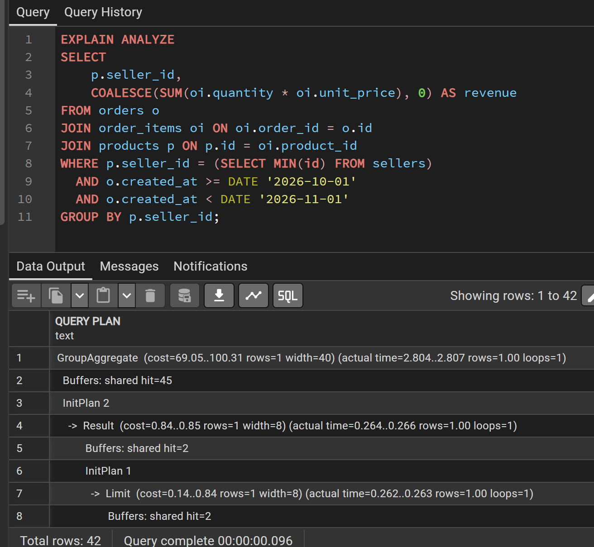
  <figcaption>Рисунок 2 — исходный план расчёта выручки продавца (на скриншоте отображена верхняя часть плана).</figcaption>
</figure>

### Задание 4. Проверка существующих индексов и создание B-tree-индексов

Перед созданием новых индексов был проверен каталог `pg_indexes`. Это необходимо, чтобы не создавать повторно уже существующие индексы.

```sql
SELECT
    schemaname,
    tablename,
    indexname,
    indexdef
FROM pg_indexes
WHERE schemaname = 'public'
  AND tablename IN ('products', 'orders', 'order_items')
ORDER BY tablename, indexname;
```

По результату проверки в базе уже имелись следующие индексы:

| Таблица | Индекс | Назначение |
|---|---|---|
| `order_items` | `idx_order_items_product_id` | поиск позиций по товару |
| `order_items` | `order_items_pk` | уникальность пары `order_id`, `product_id` |
| `orders` | `idx_orders_created_at` | поиск и фильтрация по дате заказа |
| `orders` | `idx_orders_user_id` | поиск заказов пользователя |
| `orders` | `orders_pkey` | первичный ключ `id` |
| `products` | `idx_products_category_id` | поиск товаров по категории |
| `products` | `idx_products_seller_id` | поиск товаров по продавцу |
| `products` | `products_pkey` | первичный ключ `id` |

Итого проверка показала 8 существующих индексов. Для первого запроса не хватало составного индекса, учитывающего оба условия фильтрации — категорию и цену.

<figure>
  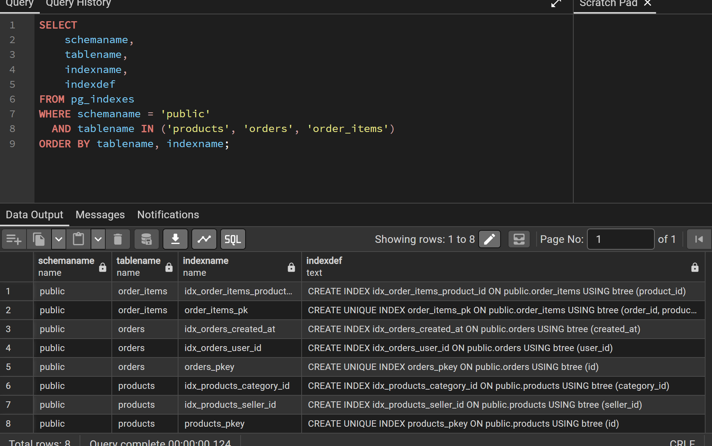
  <figcaption>Рисунок 3 — просмотр индексов таблиц products, orders и order_items.</figcaption>
</figure>

Был создан составной B-tree-индекс:

```sql
CREATE INDEX IF NOT EXISTS idx_products_cat_price
ON products (category_id, price);
```

Порядок столбцов важен: сначала идёт `category_id`, по которому задано равенство, затем `price`, по которому задано условие диапазона `< 3000`. Такой индекс подходит для данного сочетания фильтров.

<figure>
  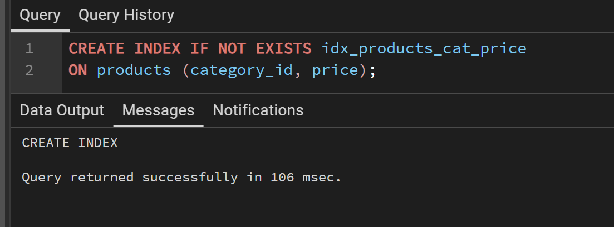
  <figcaption>Рисунок 4 — успешное создание составного индекса `idx_products_cat_price`.</figcaption>
</figure>

После создания индекса исходный запрос был выполнен повторно:

```sql
EXPLAIN ANALYZE
SELECT title, price
FROM products
WHERE category_id = 5
  AND price < 3000;
```

В новом плане появился `Bitmap Index Scan on idx_products_cat_price`, а в `Index Cond` присутствуют оба условия: `category_id = 5` и `price < 3000`. Далее PostgreSQL выполнил `Bitmap Heap Scan`, чтобы получить сами строки таблицы. Было найдено 6 строк. Фактическое время выполнения по плану составило `0.127 ms`.

<figure>
  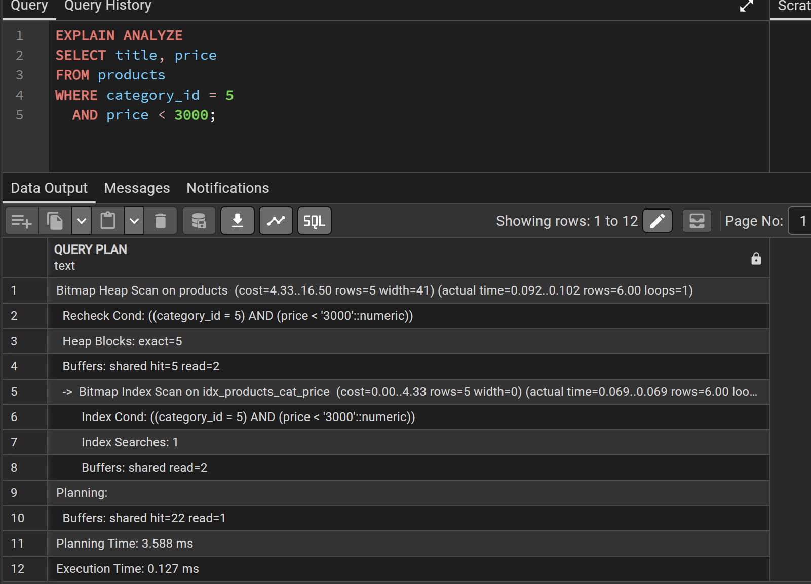
  <figcaption>Рисунок 5 — использование составного индекса `idx_products_cat_price`.</figcaption>
</figure>

**Вывод по первому запросу.** Составной индекс был задействован, и оба условия фильтрации вошли в `Index Cond`. В исходном плане использовался индекс только по категории, а условие цены проверялось отдельным фильтром. После добавления составного индекса PostgreSQL смог искать строки сразу по двум условиям.

Для второго запроса повторно использовались уже существующие индексы: `idx_products_seller_id`, `idx_orders_created_at`, `idx_order_items_product_id` и первичные ключи. Дополнительные индексы для этого эксперимента не создавались, поскольку каталог показал, что соответствующие индексы уже есть.

После создания составного индекса план запроса выручки был получен повторно. В полном текстовом результате фактическое время составило `1.748 ms`. План включал `Index Only Scan` по `sellers_pkey`, `Bitmap Index Scan` по `idx_products_seller_id`, а для `orders` и `order_items` — последовательное сканирование и соединение через `Hash Join`.

<figure>
  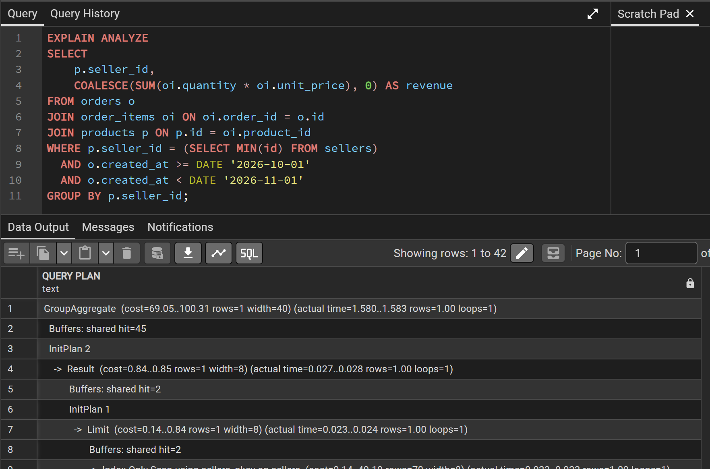
  <figcaption>Рисунок 6 — план запроса расчёта выручки после проверки существующих индексов; на изображении показана верхняя часть плана.</figcaption>
</figure>

**Почему остался Seq Scan?** Наличие индекса не обязывает PostgreSQL использовать его. Если запрос затрагивает значительную часть небольшой таблицы, последовательное чтение может быть дешевле, чем переходы по индексу и последующее чтение строк таблицы. Поэтому `Seq Scan` в данном случае не означает ошибку.

**Замечание о сравнении времени.** Для второго запроса в предоставленных материалах есть полный исходный план с `Execution Time: 1.748 ms`, а повторный скриншот показывает только верхнюю часть плана. Поэтому достоверно сравнить время «до/после» по одним изображениям нельзя. В отчёте не делается вывод о сокращении времени этого запроса.

### Задание 5. Создание GIN-индекса для JSONB

Для ускорения поиска по содержимому JSONB был создан индекс типа GIN:

```sql
CREATE INDEX IF NOT EXISTS idx_products_attrs
ON products USING GIN (attributes);
```

GIN (Generalized Inverted Index) подходит для составных значений, в том числе JSONB. Он позволяет индексировать элементы документа и эффективно выполнять проверки вхождения с оператором `@>`.

Для проверки был использован запрос:

```sql
EXPLAIN ANALYZE
SELECT title
FROM products
WHERE attributes @> '{"color": "black"}'::jsonb;
```

В плане присутствуют:

- `Bitmap Index Scan on idx_products_attrs` — поиск по созданному GIN-индексу;
- `Index Cond: (attributes @> ...)` — условие вхождения JSONB применено при индексном поиске;
- `Bitmap Heap Scan on products` — получение найденных строк из таблицы;
- `actual rows=1` — найдена одна строка;
- `Execution Time: 0.110 ms` — фактическое время выполнения по полному тексту плана.

<figure>
  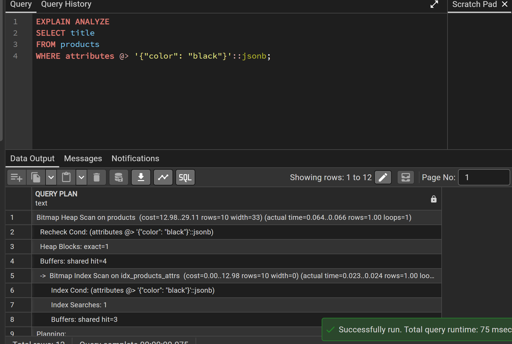
  <figcaption>Рисунок 7 — использование GIN-индекса `idx_products_attrs` при поиске по оператору `@>`.</figcaption>
</figure>

**Вывод.** План подтверждает, что GIN-индекс используется для поиска по JSONB. Оператор `@>` подходит для проверки наличия заданного фрагмента JSON-документа.

### Задание 6. Сравнение массовой вставки с индексами и без индексов

Чтобы не изменять основную таблицу `products`, эксперимент был проведён на двух временных таблицах. Одна таблица создавалась без индексов, вторая — с четырьмя индексами.

```sql
CREATE TEMP TABLE test_products_no_idx (
    id INT,
    category_id INT,
    seller_id INT,
    price NUMERIC(10,2),
    attributes JSONB
);

CREATE TEMP TABLE test_products_with_idx (
    id INT,
    category_id INT,
    seller_id INT,
    price NUMERIC(10,2),
    attributes JSONB
);
```

Для второй таблицы были созданы индексы:

```sql
CREATE INDEX idx_test_category
ON test_products_with_idx(category_id);

CREATE INDEX idx_test_seller
ON test_products_with_idx(seller_id);

CREATE INDEX idx_test_price
ON test_products_with_idx(price);

CREATE INDEX idx_test_attributes
ON test_products_with_idx USING GIN(attributes);
```

<figure>
  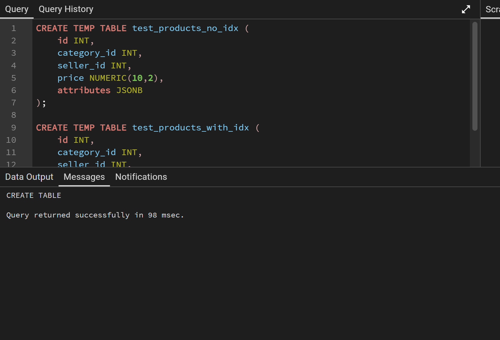
  <figcaption>Рисунок 8 — создание временных таблиц для сравнения вставки.</figcaption>
</figure>

<figure>
  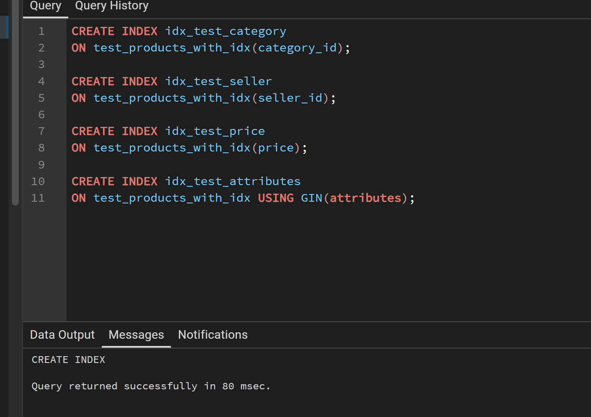
  <figcaption>Рисунок 9 — создание трёх B-tree-индексов и одного GIN-индекса на тестовой таблице.</figcaption>
</figure>

В обе таблицы вставлялось одинаковое количество данных — 20 000 строк. Значения генерировались функцией `generate_series`, а JSONB-атрибуты формировались через `jsonb_build_object`.

**Вставка без индексов:**

```sql
EXPLAIN ANALYZE
INSERT INTO test_products_no_idx
SELECT
    n,
    n % 20,
    n % 10,
    (n % 10000) + 100.50,
    jsonb_build_object(
        'color', CASE WHEN n % 2 = 0 THEN 'black' ELSE 'white' END,
        'weight', n % 1000
    )
FROM generate_series(1, 20000) AS n;
```

По плану `Execution Time` составило **76.842 ms**.

<figure>
  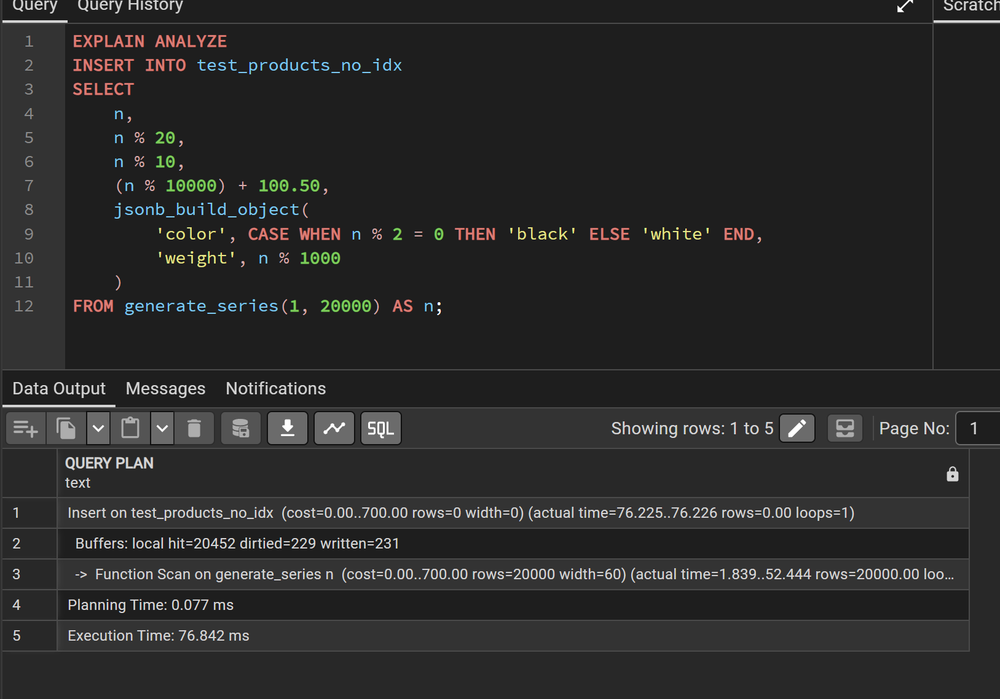
  <figcaption>Рисунок 10 — массовая вставка 20 000 строк в таблицу без индексов.</figcaption>
</figure>

**Вставка с индексами:**

```sql
EXPLAIN ANALYZE
INSERT INTO test_products_with_idx
SELECT
    n,
    n % 20,
    n % 10,
    (n % 10000) + 100.50,
    jsonb_build_object(
        'color', CASE WHEN n % 2 = 0 THEN 'black' ELSE 'white' END,
        'weight', n % 1000
    )
FROM generate_series(1, 20000) AS n;
```

По плану `Execution Time` составило **359.177 ms**.

<figure>
  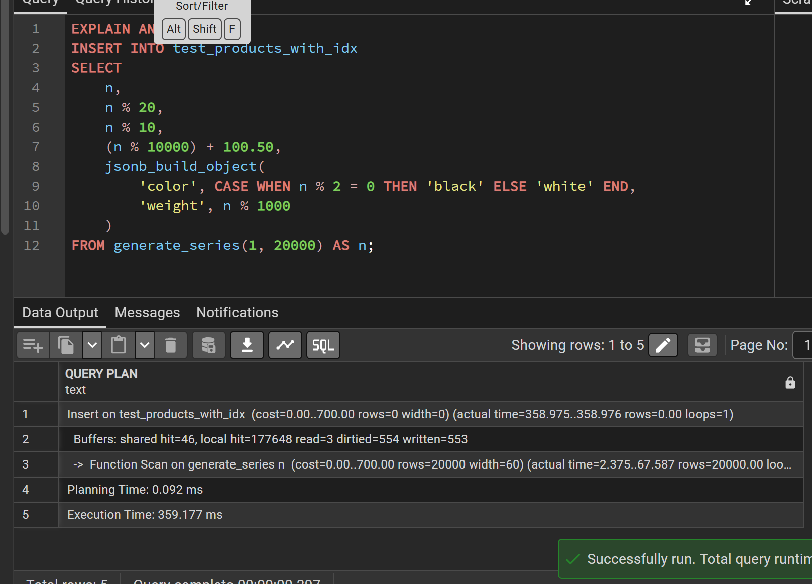
  <figcaption>Рисунок 11 — массовая вставка 20 000 строк в таблицу с четырьмя индексами.</figcaption>
</figure>

Сравнение результатов:

| Вариант | Число вставленных строк | Индексы | Execution Time |
|---|---:|---:|---:|
| Без индексов | 20 000 | 0 | 76.842 ms |
| С индексами | 20 000 | 4 | 359.177 ms |

В данном эксперименте вставка в таблицу с индексами заняла примерно в **4.68 раза** больше времени. Это демонстрирует обратную сторону индексации: при каждой вставке PostgreSQL должен не только записать строку, но и поддержать все связанные индексные структуры.

**Ограничение эксперимента.** Это единичный запуск на конкретной тестовой среде. На время могут влиять состояние кэша, дисковая подсистема, фоновые процессы и другие факторы. Поэтому результат показывает эффект в данном измерении, но не является универсальным коэффициентом замедления для любой базы данных.

### Задание 7. Обоснование выбора индексов

В ходе работы были использованы следующие индексы:

| Индекс | Тип | Для чего нужен |
|---|---|---|
| `idx_products_cat_price` | B-tree, составной | ускоряет фильтрацию товаров по категории и диапазону цены |
| `idx_products_seller_id` | B-tree, существующий | помогает находить товары конкретного продавца |
| `idx_orders_created_at` | B-tree, существующий | подходит для фильтрации заказов по диапазону дат |
| `idx_order_items_product_id` | B-tree, существующий | помогает находить позиции по идентификатору товара |
| `idx_products_attrs` | GIN | ускоряет поиск по содержимому JSONB с использованием `@>` |

Индексы выбраны не произвольно, а под конкретные условия запросов. Составной B-tree-индекс соответствует фильтрации по `category_id` и `price`. GIN-индекс предназначен для поиска по JSONB. Существующие индексы повторно не создавались.

При этом индексы не следует добавлять на каждый столбец без анализа: они занимают место и увеличивают стоимость `INSERT`, `UPDATE` и `DELETE`. Оптимальный набор зависит от реальных запросов и планов выполнения.

## 4. Сводная проверка скриншотов

| Рисунок | Что подтверждает | Проверка |
|---|---|---|
| 1 | Исходный план фильтрации товаров | Соответствует запросу; использован индекс по категории, цена применена как фильтр |
| 2 | Исходный план расчёта выручки | Запрос совпадает; скриншот показывает только верхнюю часть плана |
| 3 | Список существующих индексов | Видно 8 индексов на трёх таблицах |
| 4 | Создание составного индекса | Команда выполнена успешно |
| 5 | План после создания составного индекса | Подтверждён `Bitmap Index Scan` по `idx_products_cat_price`, 6 строк, 0.127 ms |
| 6 | Повторный план расчёта выручки | Запрос совпадает; изображение неполное |
| 7 | План запроса по JSONB | Подтверждён `Bitmap Index Scan` по GIN-индексу, найдена 1 строка |
| 8 | Создание тестовых таблиц | Команды создания выполнены успешно |
| 9 | Создание тестовых индексов | Созданы три B-tree-индекса и один GIN-индекс |
| 10 | Вставка без индексов | 20 000 строк, 76.842 ms |
| 11 | Вставка с индексами | 20 000 строк, 359.177 ms |

**Каких скриншотов не хватает для полностью наглядного отчёта:**

1. Результата добавления столбца `attributes` и заполнения характеристик товаров (задание 1).
2. Результатов трёх запросов с `->`, `->>` и `@>` (задание 2).
3. Полного плана второго запроса до и после индексации, чтобы на изображениях были видны все узлы и строка `Execution Time`.

Таким образом, имеющиеся скриншоты не противоречат описанным запросам, но не покрывают визуально все этапы лабораторной. Для недостающих этапов в отчёте приведён код и отдельно отмечено отсутствие подтверждающих изображений.

## 5. Ответы на контрольные вопросы

**1. Что такое JSONB, чем он отличается от JSON и для каких данных подходит?**

`JSON` хранит исходный текст JSON, а `JSONB` хранит разобранное двоичное представление. `JSONB` удобнее для обработки и индексирования, поскольку PostgreSQL может эффективно обращаться к его структуре. Он подходит для слабоструктурированных характеристик, которые отличаются у разных объектов. Для основных связанных данных лучше использовать обычные столбцы и таблицы.

**2. Какими операторами извлекают поля из JSONB и проверяют вхождение фрагмента?**

`->` извлекает значение как JSONB, `->>` — как текст, `#>` и `#>>` извлекают значение по пути. `?` проверяет наличие ключа, `@>` — наличие заданного JSON-фрагмента внутри документа.

**3. Что такое индекс и как он ускоряет выборку данных?**

Индекс — вспомогательная структура, позволяющая находить строки по заданным значениям без полного чтения таблицы. Планировщик выбирает индексный доступ, если считает его дешевле последовательного сканирования.

**4. Чем Seq Scan отличается от Index Scan?**

`Seq Scan` последовательно читает таблицу. `Index Scan` использует индекс для поиска подходящих строк и затем обращается к таблице за данными. Для выборки небольшой доли строк индекс часто эффективнее; для чтения большой части таблицы может быть выгоднее `Seq Scan`.

**5. Какой тип индекса используется по умолчанию и для каких условий он эффективен?**

По умолчанию PostgreSQL использует B-tree. Он подходит для сравнений на равенство, диапазонных условий (`<`, `>`, `BETWEEN`), а также для сортировки.

**6. Что показывает EXPLAIN и чем от него отличается EXPLAIN ANALYZE?**

`EXPLAIN` показывает предполагаемый план и оценочную стоимость, не выполняя сам запрос. `EXPLAIN ANALYZE` действительно выполняет запрос и дополнительно выводит фактическое время, число строк и другую статистику выполнения.

**7. Как по плану определить, используется ли индекс?**

Нужно найти узлы `Index Scan`, `Index Only Scan` или `Bitmap Index Scan` и проверить название индекса и условие `Index Cond`. Если присутствует только `Seq Scan`, индексный доступ в этом плане не использовался.

**8. Почему не следует создавать индексы на все столбцы подряд? Какова их цена?**

Индексы занимают дисковое пространство и требуют обслуживания при вставке, обновлении и удалении строк. Лишние индексы замедляют изменение данных и увеличивают расходы на хранение и обслуживание.

**9. Что такое GIN-индекс и где он применяется?**

GIN — обобщённый инвертированный индекс. Он подходит для поиска по составным значениям: JSONB, массивам и полнотекстовым данным. В этой работе GIN применён к столбцу `attributes` для ускорения проверки вхождения JSONB-фрагмента оператором `@>`.

**10. Как индексы влияют на операции вставки и обновления данных?**

При вставке или изменении строки PostgreSQL должен обновить не только таблицу, но и все затронутые индексы. Поэтому большое количество индексов может заметно замедлить `INSERT` и `UPDATE`. В эксперименте вставка 20 000 строк с четырьмя индексами заняла 359.177 ms против 76.842 ms без индексов.

## 6. Заключение

В ходе лабораторной работы были изучены и применены возможности PostgreSQL для хранения и анализа данных. Был добавлен столбец `JSONB`, заполнены характеристики товаров, проверены операторы извлечения и поиска по JSONB. С помощью `EXPLAIN ANALYZE` исследованы планы выполнения запросов до и после индексирования.

Проверка каталога показала, что часть необходимых B-tree-индексов уже существовала. Для фильтрации товаров по категории и цене был добавлен составной индекс `idx_products_cat_price`; план подтвердил его использование через `Bitmap Index Scan`. Для JSONB был создан GIN-индекс `idx_products_attrs`, который также был задействован при поиске по оператору `@>`.

В эксперименте с массовой вставкой было установлено, что 20 000 строк вставились за 76.842 ms без индексов и за 359.177 ms с четырьмя индексами. Это показало компромисс между ускорением чтения и дополнительными затратами на изменение данных.

**Общий вывод:** индексы следует создавать на основании конкретных запросов и анализа планов выполнения. B-tree эффективен для обычных условий фильтрации и диапазонов, GIN — для поиска по структуре JSONB. При этом решение об индексации должно учитывать не только скорость чтения, но и стоимость вставки, обновления, удаления и занимаемое место.
